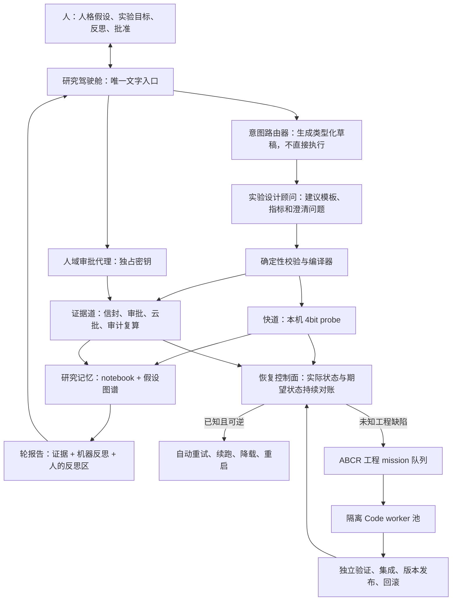

# ABCR 人格探索：单一 UI 与自动闭环可行性评估

> 日期：2026-07-19  
> 性质：独立架构评估，不是实现任务卡。  
> 范围：W1 rig、ABCR 自动化控制面、0719 两张补充消息卡，以及 Mac mini 上现有 OC/AILH 常驻体系的可复用边界。  
> 说明：0719 功能的当下合入/部署状态正由另一执行方处理，本报告不以该状态作为否决依据；评估的是这些需求全部实现后，终态是否真正成立。

## 1. 结论

**有条件可行。**

可实现的现实终态是：人只从一个入口打字；系统把文字转成可检查的实验目标或控制意图；快道实验自动在本机运行，证据道在必要审批后自动运行；已知运行故障自动恢复；未知工程故障自动进入隔离的 Code 修复流水线；所有状态、异常、证据、反思和下一轮草稿回到同一个入口。

不能承诺的字面终态是“零问题、永不卡顿”。任何包含本地模型、云主机、外部消息平台、代码生成 agent 和第三方 API 的系统都会失败。应把目标改写为四项可验收承诺：

1. **零隐藏故障**：没有超过时限仍不被发现、没有归属、没有下一步的停摆。
2. **零日常工程操作**：人不接触 Code 窗、命令、路径、配置和日志；只做科学目标、反思及少数费用/危险动作的文字裁决。
3. **有界自动恢复**：已知且可逆的故障自动恢复；未知或涉及证据有效性的故障隔离后形成一张人能理解的决策卡。
4. **科学主体不被自动化夺走**：机器可以提出设计建议、反思和下一轮草稿，但不能自行改变科学目标并把建议当成人的假设直接开跑。

因此，0719 两张卡的方向正确，但它们覆盖了“实验语义层”和“入口功能”，还缺三个承重层：**研究意图到专业实验设计的适配层、运行与工程故障的恢复控制面、跨轮研究记忆层**。

## 2. 现有基础为何足以继续建设

W1 已经提供了难以事后补救、但对自动化至关重要的底座：固定 rig、版本化配置、原始轨迹、确定性评分、激活记录、断点续跑、哈希链、信封与令牌、独立复算、审计、锁盲、预算和云生命周期。自动化三包已经把实验执行分成 Governor、Operator、Auditor 三种职责。这意味着无需另造实验系统，只需在其上增加研究语义和人机交互。

Mac mini 的现实资源是 Apple M4、16 GB 内存、约 88 GiB 可用磁盘，已装 Ollama。运行固定的 7B 级 4bit 行为探针在物理上合理；但“3 个变体 × 20 题 × 1 seed ≤40 分钟”仍必须用最终冻结的 Qwen2.5 量化工件实测，不能由硬件规格推定。

OC/AILH 侧已有可复用模式：launchd 常驻、飞书长连接、任务断点、进度展示、控制台、任务收件箱、止损和隔离分支。但应复用其纪律与部件，不能把 ABCR 直接塞进现有 AILH 队列或 BOSS 控制台：

- 现有飞书入口只支持文本；消息去重为进程内 TTL 集合，重启后不保留，不足以承载签批动作。
- 现有 BOSS 控制台明确只绑定 `127.0.0.1`，并持审批密钥；它不适合被改成网络暴露的综合后台。
- 现有 supervisor consumer 的“消费工作类指令”主要是把任务落入 `missions/code-mac/pending/`，并不等于 Code 已执行。现场还有 30 个 pending 和 5 个 in-progress 文件，最老 pending 可追溯到 6 月 10 日。这证明“已入箱”不能作为“已接手/已完成”的代理指标。
- 现有消费端历史上出现过一条无目标 pause 指令楔住全局游标 8 小时的记录。ABCR 工程任务不能再使用一个毒丸可阻塞全部后续任务的单游标队列。

这些不是对复用的否定，恰恰说明应复用经过教训提炼的机制，同时为 ABCR 建独立、可验证的执行域。

## 3. 正确的总体架构

“一个 UI”应理解为**一个前门**，而不是一个持有所有权限的单体进程。



这里有四个必须隔离的权力域：

1. **研究驾驶舱**只收文字、展示状态、生成类型化意图，不持实验签发密钥，也不直接改代码。
2. **实验控制面**按冻结协议执行和审计，不允许反思 LLM 改写计划或门控结论。
3. **工程控制面**可以让 Code agent 修复工程，但只能在隔离 worktree 工作；验证通过并发布新版本后，下一次或恢复后的 run 才使用它。
4. **人域审批代理**独占密钥，只接受持久幂等、身份白名单通过的批准事件。

实验体 Qwen 是被研究对象，不能同时担任写自己 harness、修改评分器或判定自己实验成功的工程 agent。工程任务应由独立的 Code agent 完成。

## 4. 两种闭环必须分开

当前需求把两个性质不同的闭环写在了一起。它们都需要自动化，但自动化权限相反。

### 4.1 科学闭环：自动搭台，人做裁决

```text
人提出理论想法
→ 系统形成目标书草稿并暴露歧义
→ 人确认假设与预测
→ 系统选择实验模板、执行、审计、出报告
→ 系统提出备择解释和区分性实验建议
→ 人反思、改目标或接受一个下一轮草稿
→ 新一轮
```

系统可以自动提出下一轮，但不应在没有人接受新目标的情况下自动启动。否则人的人格理论思考会被一个以当前分数为反馈的自动优化器替代，最终得到的是题池/seed/裁判过拟合，而不是饱满的人格探索。

### 4.2 运行与工程闭环：机器负责到底

```text
运行偏离期望状态
→ 分类故障
→ 已知可逆故障自动恢复
→ 未知代码故障生成 mission
→ Code agent 在隔离分支修复
→ fake 全链 + 回归 + 对抗用例 + 必要的 Mac 真链
→ 发布不可变版本
→ 从断点恢复实验
→ 驾驶舱只汇报结果或需要人的真正决策
```

这一环才应该尽可能无人化。人的输入只在以下边界出现：扩大科学目标、产生费用、访问证据隔离区、改冻结契约、降低安全/审计门、不可逆删除或无法自动判断的科学歧义。

## 5. 最大语义缺口：自然语言目标不会自动变成专业实验

卡 #1 同时要求“自然语言目标自动以专业适合的方式开启实验”和“planner 零 LLM、遇歧义终止”。这两条在开放世界里不能由一个 schema 同时满足。

一个确定性编译器能把已经结构化的目标变成信封，却不能可靠判断：某个新人格理论应该做成分消融、剂量反应、措辞稳健性、跨族匹配、轻 agentic 轨迹还是内部中介实验。若让 LLM 直接决定并执行，又会把不稳定猜测放进门控路径。

可行解是“两阶段设计”：

1. **非权威实验设计顾问**：LLM 读取人的自然语言和已有研究记忆，建议实验类型、任务族、对照、指标、功效和澄清问题；输出必须是类型化提案，并逐项说明依据。
2. **权威确定性编译器**：只接受通过 schema 的提案，检查边界后编译；不允许 LLM 绕过 split、预算、审批、锁盲和审计。

初期不要承诺覆盖“任意实验目标”，而应建立可扩展的专业模板注册表，至少包括：

- 快速行为探针；
- 人格文本 vs vanilla vs 同长度任务展开；
- 人格成分消融；
- 弱/强剂量反应；
- 改写、换序、seed、题集稳定性；
- 人格 × 任务族匹配/错配；
- 2–4 步、无跨 episode 记忆的轻 agentic 任务；
- 收敛人格的投影、注入、消融和中介验证；
- 冻结后的确认实验。

只有目标能明确映射到已验证模板时才自动开跑；否则驾驶舱用人话提出不超过三条澄清问题。模板逐步扩充，比让模型每轮即兴设计更接近“专业适合”。

卡 #1 的“LLM 只允许出现在报告/转写”应修订为：**LLM 不得进入实验门控、编译裁决、审计、复算和统计真值路径**。设计顾问与 Code worker 可以使用 LLM，但它们分别位于提案域和工程域，输出必须经确定性门验证。若维持原句字面含义，单一自然语言入口和自动 Code 工作流本身就无法成立。

## 6. 研究有效性方面需要修正的五点

### 6.1 快道是学习仪器，不是弱化版证据道

`20 题 × 1 seed` 的探针适合发现方向和生成下一轮问题，不适合宣布人格有效。面板应始终显示“学习数据 · 不可引用”，并同时显示样本量、题集重叠、seed 数和结果不确定性，不能只用绿色分差诱导人把噪声当发现。

### 6.2 IFEval 类任务不能承载“好人格”的总体判断

当前确定性 checker 强在可靠，但主要测指令遵循。若人格探索要回答“为什么在不同任务上奏效”，至少需要能让核验、探索、校准、坚持/止损等行为真实影响结果的多任务族。题库和 deterministic scorer 可以先建；人格维度与任务需求分可后标。任何单族结果都应限制为该族内结果。

### 6.3 ③ᴸ 不能被描述成真正中性

对任意中文人格文本做“同 token 长度、去人格语义、又自然且任务等价”的零 LLM 变换，没有通用可靠算法。可执行版本应是冻结的**任务展开模板**，长度按目标模型 tokenizer 匹配，并继续称“夹逼对照/任务展开对照”，不能称纯中性对照。词表无命中不等于语义无人格，仍需定期独立抽检。

### 6.4 4bit↔bf16 校准不能只看 10 条的方向命中率

方向一致率低于 0.8 的黄牌作为早期占位可以使用，但 8/10 的二元判断过于粗糙。正式面板至少同时显示：方向一致率及置信区间、效应大小衰减、变体排名相关、任务族分层结果。否则本地 4bit 可能方向相同但幅度已失真，仍被误判为可靠学习仪器。

### 6.5 机器反思必须是可复核的备择解释，不是漂亮总结

机器反思每条都应包含：证据指针、观察、至少一个竞争解释、能区分解释的下一实验、若结果相反如何更新判断。反思器只能读 dev 结果，不能自行改变目标或启动新实验。最终的人格含义与理论解释由人填写和裁决。

## 7. 跨轮研究记忆是缺失的承重件

`round_id` 能串文件，但不能防止重复发现、概念漂移和事后改写。需要在执行账本之外增加一个“假设图谱/研究记忆”，记录：

- 理论来源与构念定义；
- 人格 id/version/parent 和变化的唯一成分；
- 事前预测与可证伪条件；
- 使用过的题、seed、模型和量化档；
- 结果及不确定性；
- 四解释槽及竞争解释；
- 已排除、仍存活的解释；
- 下一轮实验与其信息价值；
- 从 probe 到证据道、从探索到冻结的谱系。

它不是重型治理账本，而是为人的思考服务的研究对象。驾驶舱应能回答：“我们为什么做这一轮？”“这个人格从哪版改来？”“过去什么结果反驳过当前解释？”“下一轮是在追分还是在区分解释？”

## 8. “不卡顿”需要恢复控制面，而不只是 watchdog

现有 ABCR watchdog 的设计是检测并告警，不自修；这对证据安全是正确的，但不足以实现用户目标。应在 watchdog 之上增加 desired-state reconciler，按故障类型采取有界动作：

| 故障类型 | 自动动作 | 是否可继续原批 |
|---|---|---|
| 进程崩溃、机器重启、网络瞬断 | 幂等重启、断点续跑、指数退避 | 可 |
| 内存压力、温度/磁盘水位 | 降并发、缩 batch chunk、暂停并清理非证据缓存 | 可 |
| judge/API 429/5xx | 退避、换时段、保持原始请求 id | 可 |
| 配置漂移、split 越界、锁盲破坏、数据污染 | 立即隔离，禁止自动“修完继续算原批” | 不可，需新批或人裁决 |
| 未知代码异常 | 冻结现场、生成工程 mission、隔离修复、验证后发布 | 视证据边界决定 |
| 科学目标有歧义、测量无效 | 给人决策卡，不让 Code 猜科学含义 | 不可 |

工程修复不能在正在执行的代码目录上热改。每批必须钉住不可变 release id；Code 修复在独立 worktree，过 fake 全链、回归、针对性故障注入和独立验证后发布下一 release。恢复时明确记录是“同版本续跑”还是“新版本新批”，禁止悄悄混合。

## 9. ABCR 工程 mission 系统的最低设计

任务收件箱本身不等于自动工程。要让人真正不接触 Code，ABCR mission 至少要有：

1. 类型化 mission：问题证据、期望结果、允许改动范围、禁止项、验收测试、回滚点。
2. 独立队列与状态：queued/claimed/running/verifying/released/failed/needs-decision；不能复用 AILH 的文件是否位于 pending 来代表真实执行状态。
3. lease 与心跳：worker 死亡后任务可回收；毒丸任务隔离，不阻塞其他任务。
4. 依赖 DAG 与路径所有权：并行 worker 不在共享 worktree 互踩；有明确集成顺序。
5. 独立 verifier：Code agent 的“完成”只是声明；必须由另一进程/agent在干净环境重跑验收。
6. 不可变发布与一键回滚：修复进入新 release，验证失败自动退回上一版。
7. 权限分级：普通代码修复可自动发布；冻结契约、云、密钥、安全边界、删除和降低门槛必须回驾驶舱审批。
8. backlog SLO：显示队列年龄、领取延迟、运行时长和阻塞原因；“已入箱”绝不能显示成“执行中”。

并行窗口和子 agent 数量只能提高吞吐，不能代替这些机制。多窗口最容易重演“三包各自全绿但跨包互不兼容”的 R1 失败，因此必须始终保留一个集成验证道和一个独立对抗道。

## 10. 唯一 UI 的产品形态

建议以**飞书中的 ABCR 研究驾驶舱**作为唯一前门：普通话自然语言输入、卡片审批、状态推送、报告和下钻链接都在同一个 bot/应用内。本地网页和 CLI 只作为运维后备，不应被描述为人的日常第二/第三入口。

驾驶舱默认只显示六类对象：

1. 我正在思考/等待确认的实验目标；
2. 快道探针与其学习结论；
3. 证据道待批、在跑和预计完成时间；
4. 轮报告与反思区；
5. 异常、自动恢复进度和真正需要人的决策；
6. 预算与模型/量化校准健康度。

人应能直接打字：

- “我想测试一个更重视反例、但不变得啰嗦的人格；预测找错题会上升。”
- “先做快道，三个变体，给我看你准备怎么测。”
- “把第 17 针毕业成证据实验，但改用未见题。”
- “批准这个云批。”
- “为什么停了？系统已经做了什么？”
- “暂停这一轮，不要丢进度。”
- “把第 3 族第 8 题的完整 prompt、输出和 judge 原始响应给我。”
- “根据这一轮给我三个下一实验方向；不要自动开跑。”

自然语言解析只能生成待校验的 typed intent。所有会花钱、签批、改冻结对象或影响证据资格的动作都要回显一行明确对象与后果，再由持久幂等事件执行。批准事件的去重必须落盘，并绑定 `message_id + sender_open_id + batch_id + envelope_hash`；不能依赖进程内缓存。

## 11. 可行性分级

| 能力 | 可行性 | 判断 |
|---|---:|---|
| 单一文字前门、状态与下钻 | 高 | 现有飞书、sync、三层钻取和本地控制台均可提供部件 |
| 本机 7B 4bit 快道 | 高但需实测 | M4/16 GB 资源合理；40 分钟是 SLO，不是已知事实 |
| 目标书→证据道全链 | 中高 | 现有 ABCR 骨架强；需补模板注册表、轮语义和审批桥 |
| 已知运行故障自动恢复 | 高 | 已有幂等、断点、心跳、watchdog；需加 reconciler |
| 未知工程故障无人修复并恢复实验 | 中 | 技术上可做，但承重在 worker 隔离、独立验证、发布回滚，不在“多开 Code 窗” |
| 任意理论目标都自动设计出专业实验 | 低，若不限边界 | 只能通过有限、可扩展且已验证的实验模板逐步覆盖 |
| 全自动“结果→反思→新目标→直接开跑” | 不应实现 | 与人作为人格假设和反思主体相冲突，也会形成自我确认优化环 |

总体上，若目标定义为“**一个前门、日常零工程、无静默停摆、已知故障自动恢复、未知故障自动形成并执行修复任务、科学目标始终由人确认**”，可行性为**中高**。若坚持“任意目标都零澄清自动设计、系统自动决定下一科学目标、绝对零问题”，则不可行，也不应该把这种承诺写进验收。

## 12. 对两张消息卡的处置建议

### 保留

- 快道/证据道双轨；
- `--predict` 唯一快道纪律和 append-only notebook；
- probe promote 后换未见 dev 子集；
- 人格种子由人自拟；
- 目标书先于审批；
- 证据道 fail-closed、split 隔离、审计复算；
- 机器反思只出建议、对 holdout 不可见；
- 人能从轮级下钻到完整 prompt 和 judge 原始请求/响应；
- 签批代理与系统执行域分权。

### 修订

1. “LLM 仅报告/转写”改成“LLM 不进入实验真值和门控路径”；允许非权威设计顾问与隔离 Code worker。
2. “面板”改成“飞书研究驾驶舱唯一前门”；本地页/CLI 明确为后备。
3. “③ᴸ 中性对照”统一称任务展开/夹逼对照，长度按 tokenizer，增加独立抽检。
4. 快慢校准从单一方向一致率升级为方向、幅度、排名和分族四项。
5. “工作类指令落箱”与“Code 已接手执行”拆为不同状态和验收。
6. 所有自动修复以不可变 release、隔离 worktree 和独立验证为前提。

### 新增

- 实验模板注册表与目标→模板适配器；
- 跨轮假设图谱/研究记忆；
- desired-state reconciler 与故障策略表；
- 独立 ABCR mission worker 池、lease、DAG、merge/release/rollback；
- 飞书批准的持久幂等与 uid 白名单；
- 面向人的可靠性 SLO。

## 13. 分阶段验收建议

### Gate 1：人机入口成立

- 20 条自然语言样例可正确分到 probe、证据实验、审批、状态、下钻、暂停/中止、工程任务七类；
- 歧义目标不执行，最多提出三条人话澄清；
- 人在全流程不接触命令、路径和 Code 窗。

### Gate 2：快道学习环成立

- 冻结模型/量化档后实测延迟；未达 40 分钟如实显示实际 ETA；
- 缺预测拒跑；断进程后自动恢复或明确重开；
- notebook 可复跑、promote 使用未见 dev 子集；
- UI 永久标明不可引用和不确定性。

### Gate 3：证据环成立

- 从人确认目标到轮报告，除批准/云参数外零人工；
- 假设先于审批、越 split、反思器越权三类攻击均被拦；
- 报告每个结论可下钻到原始证据；
- 中途重启不重复生成或重复计费。

### Gate 4：恢复环成立

- 故障演练覆盖进程死、Mac 重启、网络断、API 限流、磁盘压力、坏状态、毒丸 mission；
- 任何实验停摆在约定时限内被发现并显示下一动作；
- 毒丸不阻塞后续任务；
- 证据污染类故障不会被“自动修绿”。

### Gate 5：工程无人化成立

- 用一个无害真实缺陷演练：发现→mission→隔离 Code 修复→独立验证→发布→恢复实验，全程人不与 Code 交互；
- 故意让修复回归，验证器拒绝发布并自动回滚；
- 涉及冻结契约的修复停在驾驶舱等待文字批准。

### Gate 6：研究循环成立

- 连续三轮能展示目标谱系、父本差异、预测命中/未命中、竞争解释与下一轮信息价值；
- 机器能提下一轮草稿，但未获人的确认绝不运行；
- 系统能回答“为什么做这一轮”和“什么结果会推翻当前解释”。

## 14. 最终判断

W1 rig 和自动化骨架足够支持这一方向，不需要推倒重来。真正的项目风险不是模型跑不动，而是把“能执行实验”“能修代码”“能设计实验”“能替人反思”误认为同一种自动化。

正确的终态不是一个万能 agent，而是一个对人呈现为统一人格、后台却严格分权的研究操作系统：它替人承担执行、追踪、恢复、工程和证据整理；它帮助人思考，却不冒充人提出人格假设或替人宣布为什么奏效。
