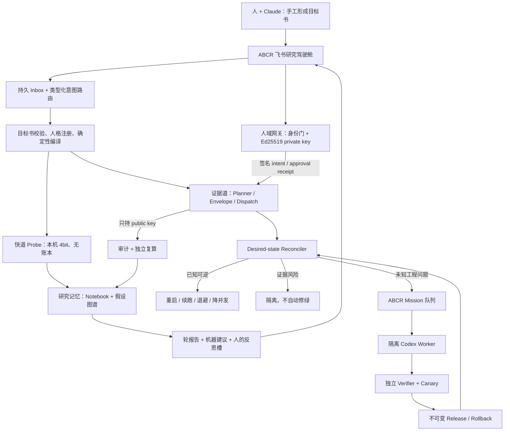

# ABCR 人格探索单一 UI 与自动闭环：实现方案 V1.0

> 日期：2026-07-19  
> 性质：可直接交给 Codex 主控执行的实施蓝图；不是目标沟通卡。  
> 权威工程位置：Mac mini `chatmac-superagent` 的 `/Users/superagent/shared-brain/ABCR/abcr`。  
> 重要前提：0719 两张卡及 R2 真执行能力与五轮加固代码的合流由另一执行方完成。本方案从“统一基线”开始，不重复修旧主仓。  
> 本轮裁决：**不开发“LLM 把自然语言变成实验提案”**。实验设计由人与 Claude 手工讨论完成；系统接收已经成形的目标书，只做确定性校验、编译、执行、审计、报告和恢复。

配套文件：`ABCR-0719-三小时工程包执行清单-V1.0.yaml`（供 Codex 主控读取）与 `ABCR-后台控制面如何和人沟通-外行说明-20260719.md`（面向非技术读者）。

---

## 0. 最终目标与三小时承诺

### 0.1 人得到的终态

日常只存在一个入口：**ABCR 飞书研究驾驶舱**。人只打字或粘贴人与 Claude 已共同定稿的目标书，不接触代码窗口、命令、路径、配置、日志和签名密钥。

后台完成两条相互隔离的闭环：

1. **科学闭环**：人和 Claude 定目标书 → 系统校验并编译 → 快道或证据道运行 → 轮报告和机器建议 → 人反思 → 人和 Claude 形成下一目标书。没有人的明确确认，下一实验绝不启动。
2. **运行/工程闭环**：发现偏离 → 已知可逆故障有界恢复 → 未知工程故障生成 mission → Codex 在隔离 worktree 修复 → 独立验证 → 不可变发布或回滚 → 继续实验。

### 0.2 “三小时完成”的准确含义

在 §1 的前置条件全部成立时，三小时工程门交付：

- 可部署的控制面 RC；
- 目标书、快道、毕业、证据道、审批、审计复算、轮报告、研究记忆的无费用全链；
- 飞书前门代码、身份门、持久幂等、审批签名和本地只读面板；
- pause/resume/abort、故障恢复器、独立 mission 队列、Codex worker、验证、发布和回滚；
- 全部非 golden 回归、fixture 全链、故障注入和独立对抗；
- 若冻结的 Qwen2.5-7B 4bit 工件已就绪，则同时完成一次真本机 probe。

三小时内不得冒充已经资格化的外部事实：

- 下一次真实云卡上的 7B bf16 批次、费用账单和 4bit↔bf16 校准；
- 真人飞书点击及飞书平台断线、重放、租户异常；
- Mac 整机重启后的恢复；
- 若开工时模型工件不存在，则 40 分钟 SLO 的真模型结论。

这些不妨碍代码 RC 形成，但必须在交付报告中列为“部署后资格化门”，不得写成 PASS。

### 0.3 非目标

- 不调用 Claude API，也不让任何 LLM 选择实验模板、补目标字段或裁定歧义。
- 不支持“随便说一句开放世界自然语言，就自动设计任意专业实验”。当前只接收人与 Claude 已写好的结构化目标书。
- 不让机器反思自动改目标、自动批准或自动发起下一轮。
- 不把快道 notebook 变成证据账本，也不让 probe import 任何账本写接口。
- 不把 ABCR 塞进 AILH 现有任务队列、BOSS 控制台或现有 Feishu handler。
- 不在运行中的 release 上热改代码；不混用修复前后的 step。

---

## 1. Gate 0：开工前置条件

主控 Codex 必须先执行本节。任何硬门失败都停止三小时计时并报告具体缺项；**不得顺手在旧主仓上补 0719，也不得用 R2 文件整块覆盖五轮加固版**。

统一基线中的 0719 实现采用“接管而非重造”规则：每个 P1/P2/P3 包开头先用 5 分钟把现有模块映射到本方案接口；已经满足契约和测试的代码原样保留，只补真实缺口。最终同一职责只能有一个状态源和一个 canonical module，禁止留下“旧 probe + 新 probe”或“两套审批桥”并行。

### 1.1 统一基线硬门

统一基线必须同时拥有：

- 五轮加固中的 token 原子消费、`consumed_ledger.py`、`cost_ledger.py`、成本门、外锚、watchdog fail-closed、队列/续跑竞态修复；
- R2 的真 `rig/runner.py`、250 题 IFEval、固定切分、云生命周期、notify、审计 items 3/5/6、周报/复现能力；
- 0719 两卡已实现或已形成可适配模块；
- 干净、可复现的基线 commit `BASE_SHA`。

已知不可作为基线的旧状态是 `5aaf86b`；R2 能力来源曾位于 `2b47aac`，但不能以整树覆盖方式合入。共享热点必须按下列优先级语义合并：

| 热点 | 必须保留的骨架 | 允许移植的能力 |
|---|---|---|
| `ops/dispatch.py` | 五轮 token/runtime/cost/lock | R2 非 fake engine、动态运行根 |
| `approval_token.py`、`consumed_ledger.py`、`cost_ledger.py` | 五轮加固版绝对优先 | 不接受 R2 删除或回退 |
| `audit/auditor.py` | 五轮 fail-safe | R2 items 3/5/6 |
| `queue.py`、`runstate.py`、`watchdog.py` | 五轮竞态与 fail-closed | R2 调用时动态根 |
| `ledgerio.py`、`repro_pack.py`、`review.py`、`resource_guard.py` | 五轮分段校验、外锚、资源门 | 只补不覆盖 |
| `rig/*`、250 题和 split | R2 功能版 | 再接本方案的人格、题目与证据资格 |

### 1.2 基线验证

主控记录以下结果到 `reports/implementation/preflight.json`：

1. `BASE_SHA`、branch、工作区是否干净；有用户改动时不 stash、不 reset，另建 worktree。
2. `scripts/preflight_kickoff.py` PASS。
3. `pytest -q -m "not golden"` 的 collect/pass 数 `BASE_PASS_COUNT`。历史硬底线为 604 个零计费用例；统一基线若已有更多，最终不得少于开工时实际数量。
4. `make contract-pkgabc test-pkga test-pkgb test-pkgc stage1-regression stage2-regression stage3-regression` 全绿；stage2 继续排除 golden。
5. `data/benchmarks/ifeval_zh_v1.json` 为 250 题，`data/splits/ifeval_zh_v1.json` 哈希合法，实物分布为 dev=42、calibration=91、holdout=117。
6. fake dispatch、独立复算、审计和三层下钻各有一个已通过的最小样例。
7. root preflight 将上述 benchmark/split 按 bytes 导入 `/Library/Application Support/ABCR-Datasets/<dataset_sha>/`，manifest 绑定 source commit/path/hash、题数和 dev/cal/holdout 计数；导入后 root-owned 只读，只有 itempool/auditor 组可读。CODE_RC 用临时镜像根验证，不直接改生产目录。

三小时估算还要求“0719 接管矩阵”达到阈值：统一基线至少已有可运行的 goal validate/compile、probe fake/notebook/promote、approval fixture、panel snapshot，以及 R2 真 runner/250 题/审计骨架；P1/P2/P3 主要做接管、加固和适配。若其中任一整条链完全不存在，这不是普通编码波动，而是估算前提失败：本方案仍是正确施工顺序，但不得继续承诺 180 分钟。

主控不能靠肉眼判断“已有”。它生成 `reports/implementation/adoption-matrix.json`，逐项记录 `canonical_module/test_node/result/elapsed_s/gap_kind(reuse|adapt|missing)`：goal validate+compile、probe fake+notebook+promote、approval fixture+panel snapshot、真 runner、250 题/split、动态 audit/rescore、五轮 token/cost/recovery 门，以及 `reconciler_fixture`、`mission_lease_fake_worker`、`sealed_test_verify_release_canary_rollback`、`service_spool_acl_smoke`。全部节点 PASS，且 goal/probe/approval 与最后四个控制面节点都只能是 reuse/adapt、不能 `missing`，才满足接管阈值；否则方案顺序仍成立，但 180 分钟承诺自动撤销。另记录三组墙钟：全 non-golden ≤480 秒、六条 fixture 旅程 ≤240 秒、launchd fake smoke+canary+rollback ≤180 秒；任一超预算也撤销承诺，继续完成但报告实际耗时，绝不跳测试赶点。

### 1.3 外部资格化前置

以下缺失时仍可完成代码 RC，但对应的 live 验收必须标 BLOCKED：

| 外部项 | 开工检查 | 缺失时的诚实结果 |
|---|---|---|
| 独立 ABCR 飞书 App | app id/secret、owner open_id、tenant、chat 均可用 | human-gateway 以 DEGRADED 启动；只能本地面板和受审 offline CLI 后备，不复用 AILH App 双开 WebSocket |
| 飞书文档镜像权限 | App 只可更新指定 ABCR 文档的标记区块，文档 ACL 已核对 | 聊天控制不受影响；`LIVE_PILOT.doc_mirror=BLOCKED`，不新建第二状态源 |
| 人域签名边界 | 固定路径 OpenSSL 3 支持 Ed25519；独立 `abcr-human` OS 用户可用；private key 仅该用户可读；public key/fingerprint 是 root-owned 只读 trust anchor | 任一缺失都不资格化 live approval v2；不得把“同 UID 下换了算法”说成系统不能自批 |
| 本机快道 | backend binary、冻结 Qwen2.5-7B 4bit artifact sha、模板 hash、1 题可加载 | 完成 fake adapter 与全部代码门；不得声称 7B 真链或 40 分钟 SLO |
| Code worker 隔离链 | 先读取本机实际 `codex exec --help` 并冻结 argv；`abcr-builder` plain-tree 沙箱、root `com.abcr.test-controller` 与降权 `abcr-candidate` 可用；trusted verifier/activator/seal-broker 的 spool/ACL 可证明 | 完成 fake worker、路径攻击和发布模拟；mission 可排队，但 UI 不得显示“正在自动修复”，`AUTONOMOUS_QUAL` 标 BLOCKED |
| 云窗 | 云参数、预算和审批均具备 | 校准代码就位，真 bf16 资格化顺延到下一云窗 |

现场只证明了 Ollama/本地模型体系存在过，未证明 Mac mini 的非交互环境可找到 backend，也未证明 Qwen2.5-7B 4bit 工件已冻结；不能以 qwen3 或 embedding 模型代替。

### 1.4 施工目录

所有实施都在 Mac mini 权威仓的临时 worktree 中进行：

```text
/Users/superagent/.abcr-build/<timestamp>/integration
/Users/superagent/.abcr-build/<timestamp>/agent-goal
/Users/superagent/.abcr-build/<timestamp>/agent-probe
/Users/superagent/.abcr-build/<timestamp>/agent-ui
/Users/superagent/.abcr-build/<timestamp>/agent-report
/Users/superagent/.abcr-build/<timestamp>/agent-recovery
/Users/superagent/.abcr-build/<timestamp>/agent-mission
```

运行态不放入代码仓或 Syncthing 目录：

```text
/Users/superagent/Library/Application Support/ABCR-Control/
  control-v1.sqlite3
  logs/
  cards/
  service-health/

/Users/superagent/Library/Application Support/ABCR-Evidence/
  ledger/ queue/ state/ runs/ reports/   # production env 的 ABCR_*_ROOT 全指向这里

/Users/superagent/Library/Application Support/ABCR-Research/
  repo/                                  # goals/personas/rounds/memory 的本机 canonical Git 仓

/Users/abcr-probe/Library/Application Support/ABCR-Lab/
  lab-notebook.jsonl rows/ snippets/

/Library/Application Support/ABCR-DevBundles/
  <bundle_sha>/manifest.json items.jsonl   # root/itempool-owned 0444；探索链只读

/Library/Application Support/ABCR-Datasets/
  <dataset_sha>/benchmark.json split.json manifest.json  # root-owned；仅 itempool/auditor 读

/Library/Application Support/ABCR-Work/
  <stage>/{ready,inflight,results,acks,quarantine,archive}/

/Users/abcr-human/Library/Application Support/ABCR-Human/
  human-control.sqlite3    # 0600，人域 Inbox/审批/Outbox
  approval-ed25519.pem     # 0600，仅 abcr-human

/Library/Application Support/ABCR-Trust/
  approval.pub             # root-owned 0444
  approval.fingerprint     # root-owned 0444；同时外锚进 protocol 链

/Library/Application Support/ABCR-Bridge/
  operator-to-human/     # content-addressed approval request；Operator写，人域只读导入
  human-to-operator/     # signed intent/token/receipt；人域写，Operator只读导入
  operator-status/       # 脱敏 ControlSnapshot；Operator写，人域只读

/Users/superagent/shared-brain/ABCR/abcr-research-backup/
  <仅已闭合 commit/bundle 的异步备份，不是热运行根>
```

本机 `ABCR-Research/repo` 是独立 Git 仓：系统自动提交人的目标书、人格版本和人的反思，避免污染钉住 release 的代码工作树。只有 fsync/commit 完成的不可变 bundle 才异步备份到 shared-brain；SQLite、热 notebook、queue、run sidecar 均不在 Syncthing 热写目录。

---

## 2. 分层完成定义

“代码已经实现”和“外部世界已经资格化”分开报告：

| 层级 | 三小时内承诺 | 判定 |
|---|---|---|
| `CODE_RC` | 全部源码、fixture/fake adapter、边界测试、六条无费用旅程、plist/ACL/sandbox 配置和 rollback 模拟 | 三小时目标；外部前置缺失不阻塞，但必须标明 |
| `LIVE_PILOT` | 真独立飞书、人域 OS/ACL、公钥锚、真本机 7B probe、真实常驻语义健康 | 依赖现场凭据/模型/管理员权限；逐项 PASS/BLOCKED |
| `AUTONOMOUS_QUAL` | 强沙箱真 Codex 修复、独立 verifier/activator、Mac 重启、真云 bf16/费用/校准 | 部署后资格化；未实测绝不由 CODE_RC 推断 |

下列是终态功能契约。`CODE_RC` 用模拟 Feishu event、临时测试 key、fake model/worker 验证同一逻辑；涉及真人平台、OS 主体、真模型/云/Code 的项目只有相应 live tier 实测后才算该 tier PASS：

1. 人能只用飞书文字导入、确认目标书，或触发 probe、promote、批准、拒绝、状态、暂停、恢复、中止、下钻和反思记录。
2. 系统没有实验设计 LLM；目标字段缺失、模板不可用或歧义时 fail-closed，并给不超过三条人话修订意见。
3. 快道缺一行预测即拒跑；只读 dev；notebook append-only；永远显示“学习数据·不可引用”；源码和传递依赖均无账本写接口。
4. `probe promote` 只生成目标书草稿，不确认、不编译；证据批的 item_ids 与本轮所有显式参考行，以及从上次证据目标定稿收据之后完成的全部 probe 行（首轮为过去 24 小时）的 item_ids 并集完全不相交。
5. 目标书原文逐字保存、单独 Git commit；目标 hash/commit/时间均绑定进每个 RunConfig；目标提交时间早于 `batch_approved`。
6. vanilla 恒带；每个人格与自己的 `length_instruct` ③ᴸ 一一配对；③ᴸ 只称“任务展开/夹逼对照”，不称纯中性。
7. persona、③ᴸ、vanilla 能经同一证据 dispatch 真正加载相应 prompt；任意 benchmark 和所有 seed 均按显式 item_ids 执行。
8. 审计不再假定 golden10/10 行；能查真实 envelope、真实 split、真实 expected rows；item 7 能拦截“假设晚于审批”。
9. 每个 step 的完整 rendered prompt 有 sidecar；下钻可见 prompt、输出、score，启用 judge 时可见原始 request/response。
10. 轮报告含 paired delta、波动、③ᴸ 位置、行为指标、固定抽样 transcript、异常格、证据指针、机器建议和人的四解释槽。
11. 飞书身份采用 open_id + tenant + chat 三重白名单；同一消息跨并发和重启只产生一次副作用。
12. 批准绑定 message/event、actor、batch、envelope hash、request version；10 次并发双击只签一个 token；旧卡、过期卡和被改信封均拒绝。
13. 生产 human-gateway 运行在独立 `abcr-human` OS 用户；Operator 只有 root-owned、不可替换的 Ed25519 public trust anchor，没有 private key；人域停机时系统不能自批。若该 OS/ACL 门未完成，`LIVE_PILOT.approval` 必须标 BLOCKED。
14. queued、claimed、running、verifying、released、failed、needs-decision 在 UI 中不混称；状态过期/损坏不能显示绿色。
15. 已知故障有界恢复；证据有效性故障只隔离；未知代码故障只生成一条 mission；毒丸不阻塞后续。
16. builder 独立 worktree/UID/强沙箱，lease、心跳、独立 verifier、canary、不可变 release 和 rollback：CODE_RC 走 fake adapter/沙箱测试，真 Codex 演练属于 `AUTONOMOUS_QUAL`。
17. 机器建议与下一目标草稿未经人确认绝不执行；反向结果不会被报告器改写成支持性结论。
18. `BASE_PASS_COUNT` 不回退，新增非 golden 测试全绿，网络/付费/真模型测试继续标 `golden`。

---

## 3. 总体架构与权力边界



### 3.1 十二个常驻/按需服务主体

| 进程 | 权限 | 明确没有的权限 |
|---|---|---|
| `com.abcr.human-gateway`（`abcr-human` 用户） | 飞书收发、人域 Inbox/Outbox、身份门、immutable approval request、Ed25519 private key | dispatch、代码修改、实验账本写入 |
| `com.abcr.operator-reconciler` | planner/dispatch、运行控制、账本、确定性恢复 | private key、代码修改、科学目标改写 |
| `com.abcr.probe-worker`（`abcr-probe` 用户/沙箱） | 只读 content-addressed dev bundle、本地模型、lab root | code repo、ledger、cal/holdout、云、approval |
| `com.abcr.itempool`（`abcr-itempool`） | 只读冻结全量 dataset、按 request 导出 dev bundle staging | ledger、模型、研究结论、任意目标路径 |
| `com.abcr.auditor`（`abcr-auditor`） | 只读全量 dataset/evidence、独立复算、audit staging | evidence 写入、approval、dispatch |
| `com.abcr.mission-builder`（`abcr-builder` 用户/沙箱） | candidate worktree、Codex、受控临时目录/egress | key、ledger、runs、launchd、active release、验证签名 |
| `com.abcr.test-controller`（root、极小 TCB） | root-owned test profile；在进程外运行 black-box oracle，fork 后降到 `abcr-candidate` 只执行被测适配器 | 网络、Codex、import candidate、接受 candidate 退出码/自报 PASS、任意测试命令 |
| `com.abcr.verifier`（独立 verifier 用户） | 只读 candidate、冻结 test profile、签 verification attestation | Codex、private approval key、active pointer |
| `com.abcr.canary-controller`（`abcr-canary`） | 从外部探测 sealed release/服务，提交 canary staging | 修改 release、信任服务自报健康 |
| `com.abcr.release-activator`（受信 TCB） | 验 verifier attestation、canary、原子 active pointer/rollback | Codex、科学目标、审批签发 |
| `com.abcr.panel` | 127.0.0.1 只读 GET、静态 materialized view | 直接 mutation、批准、dispatch、代码修改 |
| `com.abcr.seal-broker`（root、按需 TCB） | 固定操作的封存、chown/chmod、receipt、active pointer CAS | 网络、任意 target path、执行 candidate、科学/审批判断 |

Ed25519 只分开“签名能力”和“验签能力”，不会自动形成 OS 权限边界。V1 的诚实边界是**人域独占 key，不宣称 frontdoor 子模块与 signer 子模块之间有 OS 隔离**：二者同属一个最小 `human-gateway` 进程/用户，只有签名子模块打开 key；Operator、probe、builder、verifier 账户均不可读。public key 和 fingerprint 由 root 安装为只读 trust anchor，并在 protocol 链外锚；Operator 可读但不可替换。若只能同 UID 运行，代码 RC 可以完成，live approval 必须标 BLOCKED。

唯一 canonical service topology 冻结如下；plist 最终安装到 `/Library/LaunchDaemons/`，仓内文件只是经 hash 验证的安装源：

| 服务 | entry point / UID | 唯一可写目录 | 启动方式 |
|---|---|---|---|
| human-gateway | `abcr.control.human_gateway` / `abcr-human` | `ABCR-Human`、bridge 的 `human-to-operator` | KeepAlive daemon |
| operator-reconciler | `abcr.control.operator` / `abcr-operator` | `ABCR-Control`、`ABCR-Evidence`、Research 已确认区、bridge 的 `operator-to-human` | KeepAlive daemon |
| probe-worker | `abcr.probe.service` / `abcr-probe` | `ABCR-Lab` | QueueDirectories `/Library/Application Support/ABCR-Work/probe/ready` |
| itempool | `abcr.explore.itempool_service` / `abcr-itempool` | DevBundle staging | QueueDirectories `/Library/Application Support/ABCR-Work/itempool/ready` |
| auditor | `abcr.audit.service` / `abcr-auditor` | audit-result staging | QueueDirectories `/Library/Application Support/ABCR-Work/audit/ready` |
| mission-builder | `abcr.control.mission_worker` / `abcr-builder` | `.abcr-build/<mission>` | QueueDirectories `/Library/Application Support/ABCR-Work/mission-build/ready`，egress broker 受限 |
| test-controller | `abcr.control.test_controller` / `root` | test-result staging；child tmp | QueueDirectories `/Library/Application Support/ABCR-Work/test/ready`；child 降权 |
| verifier | `abcr.control.verifier` / `abcr-verifier` | `/Library/Application Support/ABCR-Attest/attestations` | QueueDirectories `/Library/Application Support/ABCR-Work/verify/ready`；只读 sealed test result |
| canary-controller | `abcr.control.canary_controller` / `abcr-canary` | canary-result staging | QueueDirectories `/Library/Application Support/ABCR-Work/canary/ready` |
| release-activator | `abcr.control.release` / `abcr-activator` | `.abcr/releases` staging | QueueDirectories `ABCR-Work/{release-prepare,activate}/ready`；active CAS 只经 broker |
| panel | `abcr.control.panel` / `abcr-panel` | 仅自己的 0600 log；ControlSnapshot 只读 | KeepAlive daemon，loopback |
| seal-broker | `abcr.control.seal_broker` / `root` | 固定 sealed roots、receipt DB、active pointer | on-demand socket；无网络、无 shell |

itempool、auditor、test-controller 与 canary-controller 都是 launchd on-demand job，不空闲常驻；`abcr-candidate` 是 test-controller fork 后立刻 setgroups/setgid/setuid + seatbelt 的一次性子进程，不是可被聊天或 builder 启动的服务。itempool 只读冻结 dataset 并导出 staging；auditor 只读全量根/evidence；candidate 看不到 test-result 目录或提交 helper；canary-controller 从服务外部验证，不信任被测服务自报。所有 sealed facts/active CAS 只经 broker。operator release/mount 明确排除全量 benchmark/split；probe/compiler/dispatch/cloud payload 只读 DevBundle，auditor另行复验。

P8 生成 root-owned `configs/control/acl-manifest-v1.json`，安装器只能按 manifest 做增量 ACL，不得把 `/Users/superagent` 改成 world-readable。关键权限固定为：

| 路径 | owner:group / mode | 允许 | 必须拒绝 |
|---|---|---|---|
| `/Users/superagent`、其 `Library`、`Application Support`、`.abcr`、`.abcr-build` 父级 | 保留原 owner/mode；按 UID 加 named ACL `search` only | 所需服务只穿越到已授权子目录 | list/read 其他 home 内容 |
| `ABCR-Control` | `abcr-operator:abcr-panel-read` / 0750；DB 0600；`public-snapshot` 0640 | operator rw；panel 只读 snapshot | panel 读 DB，human/builder 进入 |
| `ABCR-Evidence` | `abcr-operator:abcr-auditor-read` / 0750；证据 0640 | operator rw；auditor read | panel/probe/builder 写或读 |
| `ABCR-Research` | `abcr-operator:abcr-research-read` / 0750 | operator 单写；报告/镜像只读闭合 commit | probe/builder 改历史 |
| `ABCR-Lab` | `abcr-probe:abcr-lab-read` / 0750；rows/index 0640 | probe 单写；operator/auditor/readmodel 只读用于 promote/排除/audit/UI | 非 probe 写 notebook，panel 直读 Lab |
| `ABCR-DevBundles` | `root:abcr-devread` / 0550；bundle 0440 | itempool 经 seal-broker 写一次；operator/probe/auditor read | 任一消费者覆写 |
| `ABCR-Datasets` | `root:abcr-dataset-read` / 0550；dataset 0440 | 仅 itempool/auditor 读冻结 source+manifest | operator/probe/compiler/builder 进入 |
| `ABCR-Work/<stage>` | `root:abcr-work-<stage>` / 0750；sealed envelope 0440 | registry 指定 producer enqueue、consumer claim/result、producer ack，均经 broker | 任一方跨 stage、直接 rename/delete/改 sealed payload |
| `ABCR-Trust` | `root:wheel` / 0555；pub/fingerprint 0444 | 所有人只读公钥 | 非 root replace/rename |
| `Bridge/operator-to-human` | `abcr-operator:abcr-human` / 0750；final 0640 | operator 写、human 读 | human 改写原 request |
| `Bridge/human-to-operator` | `abcr-human:abcr-operator` / 0750；final 0640 | human 写、operator 读 | operator 改写 signed fact |
| `Bridge/operator-status` | `abcr-operator:abcr-human` / 0750；final 0640 | operator 原子写脱敏 snapshot；human 读 | human 改状态、snapshot 携密钥/确认期内容 |
| `ABCR-Attest/test-results` | controller staging + broker；final `root:abcr-verifier` 0440 | 受信 test-controller 一次提交、verifier 读 | `abcr-candidate` 看见/写结果，controller 提交后改、builder/verifier 执行 candidate |
| `ABCR-Attest/attestations` | verifier staging + broker；final `root:abcr-activator` 0440 | verifier 一次提交、activator 读 | verifier 提交后改、builder 读 |
| `ABCR-Attest/audit-results` | auditor staging；broker final `root:abcr-operator` 0440 | auditor 一次提交、operator/readmodel 读 | auditor 提交后改、operator伪造 audit PASS |
| `ABCR-Attest/canary-results` | canary staging；broker final `root:abcr-activator` 0440 | canary-controller 一次提交、activator 读 | 被测服务/activator伪造 canary PASS |
| `.abcr/releases`/`active` | `abcr-activator:abcr-release-read` / 0750；release 0550 | activator 单写/CAS；operator 只读启动 | builder/verifier/operator 改 active |
| `.abcr-build/<mission>` | root 创建后按阶段切 ACL | build 阶段 builder rw plain tree；freeze 后撤 builder；candidate/test/verifier/activator 只读 sealed snapshot，各自 tmp 分离 | canonical `.git`/objects 可达、test 写源码、builder 读 attest/release、阶段回退重获写权 |

安装后的 `ops/acl/install-acls.sh --check` 必须逐 UID 运行正反 open/list/create/rename 探针，包含每一级父目录 traverse；只要某个“应允许”失败或“应拒绝”成功，相关 live tier 就 BLOCKED。测试使用临时镜像根，CODE_RC 不修改真实 home ACL。

所有上表的 root 封存都只能调用同一个 `com.abcr.seal-broker`，不是 setuid shell。broker 通过 root-owned Unix socket 接 strict `SealRequest(op,source_id,source_relpath,expected_manifest_sha256,expected_size,nonce,fencing_token,subject_id)`，用 peer credentials 识别 caller；请求**没有 target path**。root-owned registry 将 `(caller_uid,op)` 映射到唯一 staging root、derived destination、目标 owner/group/mode、单文件/finite-tree 类型和大小上限。封存操作只允许 `seal_approval_bundle|seal_dev_bundle|seal_audit_result|seal_test_result|seal_attestation|seal_canary|seal_release`，另有固定 work-state 操作与 `activate_release`。

单文件用预打开 dirfd + `openat/O_NOFOLLOW`，fstat 校验 owner、regular、link count=1、device/mount、inode/size并从 fd 重算 hash。DevBundle、ApprovalRequestBundle 和 release 是 finite tree：manifest 必须列出全部规范化相对路径、mode、size、content hash；broker 以 dirfd 只遍历 manifest 所列 regular files，拒绝多余/缺失/重复 Unicode path、symlink、hardlink、special、mount crossing。它在目标父目录创建 tmp tree，逐文件复制/fsync，目录后序 fsync，整体 chown/chmod 后以单次目录 rename 发布，再 fsync parent；不能逐文件暴露半包。one-shot ledger 以 `op+nonce+fencing_token+manifest_hash` 唯一；相同重试返回同一 root-owned receipt，冲突重放拒绝。`restart_generation` 是另一个固定 op：只接受 service-label allowlist 和 target generation，不接受命令；broker 验 PID UID、proc executable/current release、目标 active receipt 后写 generation，`kill(2)` 发 TERM，超时才 KILL，由 launchd KeepAlive 重拉；on-demand 服务下一次自然取新版本。

发布顺序固定为 activator 从 sealed candidate/attestation 生成 release staging → broker `seal_release` 为 root-owned 0550 tree → canary-controller 测**该 sealed tree**并 `seal_canary` → broker `activate_release` 复验 release/attestation/canary 都绑定同一 manifest 和 expected-active CAS 后写 active。broker 无网络、无 subprocess、无通用 copy/chown API；任意路径、跨 spool、symlink、mount swap、TOCTOU、错误 owner、过期 fencing 或 broker 缺失均 fail-closed 并进审计。

不同 UID 不共享写 Control DB；所有按需工作经 `ABCR-Work`。P0 冻结 `WorkEnvelope(stage,work_id,idempotency_key,subject_id,payload_ref,payload_sha,producer_domain,consumer_uid,release_id,attempt,fencing_token,deadline)` 和 root-owned stage registry。producer 将 staging payload 交 broker `enqueue_work`；broker 由 stage 推导 `ready` 目标并 seal，launchd 只观察对应 ready 目录。consumer 经 peer-credential `claim_work` 后由 broker 原子移到 inflight、签发 lease/fencing；heartbeat/result/ack 仍只经 broker，consumer不能删除 ready，producer不能改 inflight/result。结果 sealed 后 producer read/ack，broker 才归档并清空 QueueDirectories marker。lease 超时可重排同 work_id/新 fencing；迟到结果拒绝。坏 schema/毒丸只进该 work 的 quarantine，不存在全局游标。broker ledger 和各域本地 effect 表用 work_id/request hash 对账，崩溃后不重复科学/费用副作用。

stage routing 不留给实现者猜，默认最大 lease/TTL 固定如下；只有 root-owned profile 能向下收紧：

| stage | producer → consumer | request → sealed result；谁读 | max lease / TTL | PASS 后下一步 |
|---|---|---|---:|---|
| `itempool` | operator → itempool | SelectionRequest → DevBundleReceipt；operator/auditor read | 2m / 10m | compile |
| `probe` | operator → probe-worker | ProbeRequest → ProbeResultReceipt；operator read | 45m / 60m | notebook/readmodel |
| `audit` | operator → auditor | AuditRequest → AuditAttestation；operator read | 20m / 30m | accepted/report |
| `mission-build` | operator → builder | MissionBuildRequest → CandidateSnapshotReceipt；operator read | 20m / 30m | test |
| `test` | operator → root test-controller | TestRequest → sealed TestResult；verifier read、operator只读 PASS/FAIL receipt | 15m / 20m | verify |
| `verify` | operator → verifier | VerifyRequest → VerificationAttestation；activator read、operator只读 receipt | 5m / 10m | release-prepare |
| `release-prepare` | operator → activator | ReleasePrepareRequest → sealed ReleaseReceipt；operator/canary read | 5m / 10m | canary |
| `canary` | operator → canary-controller | CanaryRequest → sealed CanaryReceipt；operator/activator read | 3m / 5m | activate |
| `activate` | operator → activator | ActivateRequest(expected-active) → ActivationReceipt；operator read | 1m / 2m | semantic health/report |

只有 Operator 根据 sealed receipt 编排下一 stage；consumer 不能自己跳阶段。test/verify 的敏感 bundle 按表只给下一受信主体，Operator 只凭 broker receipt 推进。任何 FAIL/quarantine/expiry 都回 Operator incident，不自动走下一步。

### 3.2 不直接复用 OC/AILH 的原因

- 现 Feishu 去重仅在内存，重启即失效；且缺 owner UID/chat/tenant 白名单。
- 现 handler 每事件起无界线程，控制命令和 pipeline 同进程，不能承载签批。
- 现 supervisor 的文件落箱不等于 Code 已执行，且单毒丸曾楔住全局游标约 8 小时。
- BOSS console 绑定本地但同进程持 key 和 mutation 接口，不能网络化为 ABCR 单体后台。

只移植长连接、回复、4000 字分片、原子落箱、lease、毒丸隔离、127.0.0.1 和语义健康检查的做法；ABCR 不 import AILH runtime，也不共用队列、数据库或 key。

---

## 4. 冻结的数据契约

### 4.1 控制库

使用 Python 标准库 SQLite，WAL 模式；目录 0700、文件 0600，启动时只允许 expand-only migration。逻辑 schema 分成两个权限域，而不是让 Operator 可写人的审批库：

- `human-control.sqlite3` 归 `abcr-human`，保存 Feishu inbound、owner identity、approval request/token/consume、human outbox/effects；Operator/mission worker 无读写权。
- `control-v1.sqlite3` 归实验控制域，保存已导入的普通 commands、incidents、recovery、missions、releases 和 service health；不保存 private key 或可伪造的人域身份事实。
- Operator→人域：Operator 生成 self-contained `ApprovalRequestBundle`，含 canonical envelope、原始 goal bytes、normalized hash、goal repo commit/path 的最小 Git blob/tree/commit proof、`artifact_frozen` entry、protocol prefix/外锚 receipt proof、cost/risk summary 和各 hash；经 broker 封存到 `operator-to-human/<request_id>-<sha>/`。human-gateway 只读该 bundle，用 root-owned anchor/Git-proof verifier 复算，不挂载 Research/Evidence；缺 proof、替换 bytes、截断 prefix或 receipt/head 不符都不出卡、不签名。Operator 无法决定人的 decision。
- 人域→Operator：所有普通 mutation intent、approval token、consumption receipt 分别用独立 strict schema 和 scope，由 human-gateway Ed25519 签名后写入 `human-to-operator/<event_id>-<sha>.json`；Operator 只能读并复制进自己的 DB，不能覆写/删除人域事实。只读状态查询不产生 mutation intent。
- Operator 每次从同一个 `ControlSnapshot` 生成两份同 `snapshot_hash` 的最小投影：`ABCR-Control/public-snapshot` 供 panel 读，`Bridge/operator-status` 供 human-gateway 读；前者可含本机下钻 URL，后者只含飞书回答所需状态/原因/动作，二者都不含 secret、未解锁确认方向或 mutation capability。human/panel 只有读权，不能借 snapshot 写 command。每个方向都有 source_event/effect id、payload hash、ack/reconcile 表；文件留存，消费不靠 rename/delete。

核心逻辑表如下：

| 表 | 主键/唯一约束 | 用途 |
|---|---|---|
| `inbound_events`（人域） | `(app_id,tenant_key,event_type,event_id)` | 消息/卡片先落库再 ACK，跨重启去重 |
| `commands` | `idempotency_key UNIQUE` | typed intent 状态与结果 |
| `outbox`（分域） | `dedupe_key UNIQUE` | 发送失败重试，不重复副作用 |
| `proposal_imports` | `proposal_id` | 多段目标书导入和原文 hash |
| `approval_requests`（人域） | `request_id`、`batch_id+envelope_sha+version UNIQUE` | pending/approved/rejected/expired/superseded CAS |
| `incidents` | `incident_id`；active 状态下 `fingerprint` partial UNIQUE | 实际状态与期望状态偏差；resolved 后同类可形成新 occurrence |
| `recovery_actions` | `action_key UNIQUE`（含 incident_id） | 单次 occurrence 内自动动作幂等、依据可解释 |
| `missions` | `mission_id`、`idempotency_key UNIQUE` | 独立工程任务状态 |
| `mission_dependencies` | `(mission_id,depends_on)` | DAG 与 ready 判定 |
| `mission_leases` | `mission_id` | owner、lease_until、heartbeat |
| `releases` | `release_id`；tree/runtime/lock/config manifest 组合唯一 | verified/canary/active/rolled_back |
| `service_health` | `service_name` | pid、version、last_poll、last_success、last_error |
| `effects`（分域） | `effect_id UNIQUE` | prepared/applied/confirmed，逐副作用崩溃对账 |

所有 claim 用 `BEGIN IMMEDIATE` + 条件 UPDATE。外部副作用不承诺不可实现的“物理 exactly-once”，而采用 effectively-once 协议：先持久化 deterministic `effect_id`、payload hash 和 prepared record；下游也接受相同 idempotency key；执行后标 applied；通过回读账本/token/queue/API 确认后标 confirmed。崩溃恢复只对账同一个 effect，不生成新的 token id、ledger event 或 dispatch。未知/过期投影为灰色 UNKNOWN，已证实损坏投影为红色 RISK；二者都不得默认成功。

### 4.2 目标书 V1

目标书使用 YAML，原始字节逐字存档；上限 64 KiB。自定义 SafeLoader 必须在构造前拒绝 duplicate key、alias/anchor、自定义 tag，并限制总 scalar 字节、node 数、列表长度和嵌套深度；不能使用 PyYAML 默认“后键覆盖前键”的行为。Pydantic `extra=forbid`。模板如下：

```yaml
goalbook_version: "1.0"
design_origin: human_claude_manual
goal_id: G-20260719-001
round_id: R-20260719-001
title: 测试“主动找反例但不增加啰嗦”的人格
hypothesis_text: |
  人的原始假设，系统逐字保存，不改写。
falsification_text: |
  若找错类任务无提升，或提升完全由长度解释，则当前假设降权。
template_id: persona_control_v1
parent_round_id: null
split: dev
model_profile: qwen25_7b_bf16_v1
families:
  - family_id: ifeval_zh_v1
    items_per_arm: 20
personas:
  - persona_id: px-counterexample
    version: 1
    parent: null
    theory_label: 反例敏感性
    changed_component: 新增主动搜索反例的行为规则
    components:
      - component_id: counterexample_search
        text: 在作答前主动寻找至少一个可能推翻初始判断的反例；若未找到，不虚构。
    spec_text: |
      在作答前主动寻找至少一个可能推翻初始判断的反例；若未找到，不虚构。
    dose: strong
    predictions:
      ifeval_zh_v1: increase
    falsifier: 正确率不升且输出长度显著上升
arms:
  vanilla: true
  length_control: true
length_control:
  template_id: task_expansion_zh_v1
  max_token_delta: 0
seeds: [1]
budget:
  gpu_hours_max: 2.0
  cost_cap_cny: 30.0
deadline_hours: 12
probe_lineage:
  referenced_row_ids: []   # 人与 Claude 实际看过或引用过的所有 probe；不得漏报
update_rules:
  positive: 增加改写稳健性实验
  null: 检查功效与任务匹配
  reverse: 降权反例敏感性假设并检查干扰机制
```

确定性校验至少包括：

- `design_origin` 必须为 `human_claude_manual`；系统不接受自己生成的权威设计。
- `split` 必须严格为 dev；模型 profile、template、family 均须存在且 `ready=true`。
- persona 1–3 个；id/version/parent/theory/结构化 components/唯一变化/spec/dose/逐族预测/falsifier 齐全；`dose ∈ {weak,strong}`，每个 family 恰有一个 `increase|decrease|no_change` 预测。
- vanilla 恒为 true；③ᴸ 要么对每个人格生成成功，要么整个 goal 失败。
- seeds 1–5 个；题量为正且不超 dev 可用容量；预算和 deadline 合法。
- `probe_lineage.referenced_row_ids` 必须存在且可为空数组；非空时每个 row/hash 均可复验。系统自动计算的审计排除窗口不接受目标书覆盖或缩窄。
- 缺失、越界或 unsupported template 返回按字段排序的人话缺陷清单；不补默认科学含义。

### 4.3 目标书定稿锚

导入只产生 `imported`；人输入 `确认目标 <goal_id>` 后，系统才：

1. 再跑完整校验；
2. 将原始 YAML 与规范化 JSON 写入独立 `${ABCR_RESEARCH_ROOT}/repo` 仓；
3. 单写者锁下 `git add -- <goal paths>`、自动 commit；
4. 记录 `goal_sha256`、`goal_commit`、`goal_commit_ts` 和 JSON Pointer；
5. 在任何 draft/approval 前，复用既有 `protocol.artifact_frozen` 将 `artifact_kind=exploration_goal`、goal hash/commit、控制库 receipt id 和 receipt time 追加到可信哈希链并做外锚；
6. 将相同的 `research` 对象放入每个 RunConfig，因而被 envelope hash 覆盖。

不扩充 steps 的 48 字段，也不必改变 envelope 顶层 schema。每个 RunConfig 的扩展字段为：

```json
{
  "research": {
    "round_id": "R-20260719-001",
    "goal_id": "G-20260719-001",
    "goal_repo": "abcr-research://repo",
    "goal_path": "goals/G-20260719-001/goal.yaml",
    "goal_sha256": "...",
    "goal_commit": "...",
    "goal_commit_ts": "...",
    "goal_anchor_entry_hash": "...",
    "goal_anchor_receipt_id": "...",
    "goal_anchor_receipt_head": "...",
    "release_id": "...",
    "release_tree_hash": "...",
    "release_lock_hash": "..."
  }
}
```

审计 item 7 从真实 envelope 读取各 RunConfig，要求 research 元数据完全一致，并用 `git show <commit>:<path>` 复算字节 hash。`protocol` 与 `batches` 是不同链，禁止拿各自 seq 直接比较。因果门采用显式引用：approval request/token 和 `batch_approved` payload 必须引用已存在且已外锚的 `goal_anchor_entry_hash/receipt_id/receipt_head`；签批代理在签名前独立验证 `artifact_frozen` 位于该外锚 receipt 所承诺的 protocol prefix，并复算 goal bytes。`batch_approved` 还必须记录 `token_id` 与 `origin_signature_hash`，read model 只有复验原 token 后才显示“人已批准”，不能相信 Operator 可自行写的批准事件。审计复验上述引用和 token issued/receipt time，并把 `goal_commit_ts < batch_approved.ts` 作为附加检查。任一缺失、引用不存在、外锚在签批后、commit 内容或 hash 不符即 FAIL。

P1 不拥有 protocol ledger writer：它只返回 `GoalAnchorCandidate(goal bytes/hash/commit)`。P8/Operator 以 prepared→applied→confirmed 的幂等 effect 写 `artifact_frozen`、取得外锚 receipt，再返回不可变 `GoalAnchor`；compiler 只接受最终 `GoalAnchor`。这样科学编译包不能自行制造“已冻结”的可信事实。

### 4.4 人格和 ③ᴸ 工件

人格工件：

```text
${ABCR_RESEARCH_ROOT}/repo/personas/<persona_id>/<version>/persona.json
```

字段含 id/version/parent/theory_label/components/changed_component/spec_text/dose/goal pointer/hash；抽取题集可 null；measurement anchor 与 tested persona 用 `role` 区分，optimistic/conscientiousness 不会误入待测集。若有 parent，compiler 对 canonical parent/child 工件做结构 diff：除 version/goal pointer 与 `changed_component` 指向的一个 component 外，其余冻结字段必须逐字节相同；`spec_text` 由冻结 components 顺序确定性渲染。否则不能声称“只变一个成分”，并拒绝 component-ablation 模板。

③ᴸ 使用既有 condition `length_instruct`，不新增 condition。生成算法：

1. 以目标模型冻结 tokenizer 计算 compiler 最终写入的完整 persona `prompt_text` token 数（不是未经包装的草稿字段）；persona 与③ᴸ使用同一 chat wrapper；
2. 从 `task_expansion_zh_v1` 的冻结任务展开短句库做有界组合；
3. 只允许纯任务展开短句和冻结 filler；
4. 目标为 exact token count；不可达时拒绝并要求缩短 persona 或经契约评审扩展冻结短句库，不接受任意 `control_text` 绕过任务展开语义；
5. 记录 tokenizer hash、模板版本、目标/实际 token、文本 hash、hedging/self-check 命中率；
6. 运行冻结的 `manipulation-check-3l-v1`：所有片段 source id 均来自批准短句库、标准化后没有库外字节，至少覆盖模板要求的 task-expansion slot，persona/theory/affect 禁词命中为 0，hedging/self-check 不得超 profile 上限；任一项失败整个人格对拒绝，不允许只警告；
7. runner 在最终 chat serialization 后重新 tokenize persona/③ᴸ 全输入并确认等长；编译时相等、运行时不等也拒跑；
8. 报告固定写“任务展开/夹逼对照；通过的是冻结操作检查，不证明语义中性”。

产物位于 `${ABCR_RESEARCH_ROOT}/repo/personas/_controls/3l/<sha256>.json`。

### 4.5 审批 token V2

现有 HMAC 的“验签 key = 签发 key”，不能提供真实的签发权隔离。V1 增加向后兼容的 Ed25519 token v2；旧 HMAC 只保留 fixture/历史回归，生产 Operator 拒绝 v1。异常后备也不能让日常 `superagent` 账户直接读取 private key：人明确执行 `abcrctl approve-offline ...` 后，它只把固定 schema 请求交给 root 安装的受审 wrapper；操作系统再次认证管理员，再以 `abcr-human` 身份运行固定签名二进制、写人域审计和 v2 decision。若管理员授权、人域存储或 key 不可用，就保持待批；不得回退 v1 或复制 key 绕过生产门。

token payload 不含 signature，按 compact canonical JSON 签名：

```json
{
  "token_version": "2.0",
  "alg": "Ed25519",
  "key_id": "<public-key-fingerprint>",
  "aud": "abcr-operator",
  "deployment_id": "abcr-macmini-prod-v1",
  "protocol_ref": "EXPLORATION-CONTROL-V1#approval-v2",
  "token_id": "<uuid>",
  "scope": "batch_approve",
  "request_id": "APR-...",
  "request_version": 3,
  "source_event_id": "evt-...",
  "tenant_key_hash": "...",
  "chat_id_hash": "...",
  "app_id_hash": "...",
  "decision_nonce_hash": "...",
  "goal_anchor_entry_hash": "...",
  "goal_anchor_receipt_id": "...",
  "batch_id": "B-...",
  "envelope_sha256": "...",
  "approver_id_hash": "...",
  "issued_at": "...",
  "expires_at": "...",
  "signature_b64": "..."
}
```

签批代理每次按 request id 从人域不可变快照重读 envelope 并复算 hash；卡片 value 只含 request id、expected version、一次性 nonce，不信任客户端传来的 batch/hash。严格 schema `extra=forbid`，JSON 解析拒绝 duplicate key。签名前先持久化 token_id、issued/expires 和完整 canonical preimage；崩溃重试签同一 payload、返回同一 token。Operator 用 root-owned public key 验签；v2 只复用五轮加固的原子/幂等语义，不调用 HMAC `consumed_ledger`，实际消费走下述独立 claim journal。

canonical preimage 定义为移除 `signature_b64` 后的 UTF-8 compact canonical JSON（key 排序、`ensure_ascii=false`、禁止 NaN/Inf）。验签还要确认 `source_event/request_version/tenant/chat/app/nonce` 与 request snapshot 一致，拒绝 future-issued token、超过 scope 最大 TTL 的 token和不可解释的时钟回拨。

`key_id` 精确定义为公钥 SPKI DER 字节的 SHA-256 小写十六进制；`aud/deployment_id/protocol_ref` 必须与 root-owned 部署配置逐字节匹配，防 fixture、另一台 ABCR 或旧协议重放。base64 解码只接受 canonical RFC 4648 表示（标准 alphabet、必需 padding、解码后再编码完全相同），拒绝宽松别名。

key rotation 不能由 Operator 自报：正常轮换需旧 private key 签 rotation statement，再由 root 原子安装新 trust anchor；旧 key 丢失时走线下 root-owned 更新和人确认。rotation 记录 old/new key_id、生效、retire、revocation 窗；token 只接受 issued_at 时 active 的 key，紧急撤销后拒绝未首次 claim 的旧 key token。

现 `consumed_ledger` 的 keyed anchor 使用 HMAC secret，不能拿公开 Ed25519 key 代替。HMAC v1 继续用旧 store；v2 由 human-gateway 维护独立、Ed25519 签名的授权 claim journal：

```text
unseen → claimed(token_id,batch_id,envelope_sha,release,first_claim_ts,claim_id)
       → settled(batch_dispatch_started_event_id)
```

首次 claim 必须在 token expiry 内，并发生在任何计费/生成副作用前；同一 batch+envelope+release 的崩溃恢复返回同一个 claim/receipt，其他用途全拒。expiry 只约束首次 claim，恢复还受 envelope deadline 和 retry policy。Operator 必须同时看到匹配的 `batch_approved` 稳定 event_id 才能请求 claim；claim 后以同一 effect id `append_once(batch_dispatch_started)` 并确定性 enqueue，随后回传 event id 令 claim settled。每两个步骤之间的 crash 都由 reconcile 恢复，不会出现“先消耗后永远不能续”或“先花钱后才发现 token 过期”。

跨域 saga 顺序固定：human-gateway prepare 稳定 token/decision ids → 签名并发布 immutable decision token；Operator 验签后以同一 effect id `append_once(batch_approved)` 并确认链/外锚 → 向人域提交 claim request；human-gateway 原子创建/返回稳定 claim receipt；Operator 验 receipt 后 `append_once(batch_dispatch_started)` → enqueue deterministic runs → 回传 event id 令 claim settled。human-gateway 从不直接写实验账本，Operator 没有签名能力；任何重试复用原 id。

writer 不允许实现者自行选择：decision/token/claim journal 只由 human-gateway 写；`batch_approved`、`batch_dispatch_started` 和实验 queue 只由 Operator 写；Operator 回传 settled event id 后 human-gateway 只更新人域 claim；read model 只读并交叉验证两域事实。任何一步由错误 UID/模块写入，contract test 直接失败。

`batch_approve` 的 target 是完整 envelope hash，因而包含 cost cap；契约修订后，其首次 claim 同时是该 batch 的精确 cost grant，生产不再依赖可由系统写通配值的 `ABCR_APPROVE_COST`。旧环境门只保留 fixture。云开机、冻结契约和高风险 mission 使用各自 scope（`cloud_provision`、`contract_change`、`mission_high_risk`），每个 token 都绑定 target hash/version/expiry，绝不复用 batch token。

本改动走明确契约修订：增加 token/claim v2、scope 词表，以及带 `service_session_id` 的 `approval_agent_started`、`approval_agent_heartbeat`、`approval_agent_stopped`、`approval_agent_unclean_recovered` 和 `approval_key_rotated` protocol 事件；approve/reject/timeout 分别复用 `batch_approved`、`batch_rejected`（timeout 的 reason_code=`APPROVAL_EXPIRED`），不增加多余批次事件。GENESIS、HMAC v1 规范化、envelope hash 排除 approval 等旧不变量完全不动。

### 4.6 Probe notebook 行

canonical 行先计算 `row_sha256 = SHA256(compact canonical JSON excluding row_sha256)`，再写 `${ABCR_LAB_DIR}/rows/<row_id>.json.tmp`；固定持久化顺序是 `fsync(tmp file) → atomic rename <row_id>.json → fsync(rows directory) → flock append index → fsync(index)`。索引只含 `row_id,row_sha256,row_path`，本身可从 row bundles 全量重建。启动恢复时逐 bundle 复算 preimage/checksum；JSONL 只允许截断最后一个无换行/解析失败的尾片，中间坏行或 bundle/hash 不符立即 quarantine，绝不“跳过继续”。每个 row bundle 至少包含：

```text
schema_version,row_id,ts,prediction_original,persona_ref/persona_sha256,
benchmark_id,benchmark_sha256,split_manifest_sha256,selection_seed,
selection_hash,dev_bundle_sha256,item_ids,seeds,engine_backend,engine_version,
model_id,artifact_sha256,quantization,template_hash,decoding_hash,scorer_id,scorer_version,
probe_code_release,arm_prompt_output_pointers,arm_scores,paired_deltas,
behavior_metrics,summary,row_sha256,citable=false
```

临时 persona 原文进入 `${ABCR_LAB_DIR}/snippets/<sha256>.txt`。notebook 只能 append，不提供 edit/delete。`promote(row_id)` 输出目标书 draft，并携 row hash 和 item_ids；不自动确认。

### 4.7 运行与 mission 状态机

```text
proposal: imported → invalid | validated → human_confirmed → compiled
          → awaiting_approval → running → reported → reflected

incident: detected → classifying → recovering
          → resolved | mission_queued | quarantined | needs_human

mission: queued → claimed → running → verifying
         → released | failed | quarantined | needs_human
```

任何状态转移均用 compare-and-swap；`pending` 不能展示为 running，worker 自报 completed 不能展示为 released。

---

## 5. 共享脊柱：必须先修的真实接线

本节由主控/集成者单写。其他子 agent 只能调用接口，禁止碰共享文件。

### 5.1 人格与 ③ᴸ 真执行

统一 RunConfig 约定：

```json
{
  "condition": "persona_text",
  "intervention": {
    "trait": "px-counterexample@1",
    "prompt_text": "...",
    "prompt_sha256": "...",
    "artifact_ref": "personas/px-counterexample/1/persona.json"
  }
}
```

③ᴸ 将 condition 改为 `length_instruct`，其余字段相同并增加 `control_role=task_expansion_bracket`。修改 `rig.runner.build_system_prompt`：

- `persona_text` 和 `length_instruct` 优先读取 envelope 已绑定的 inline `prompt_text`；
- 每次复算 `prompt_sha256`；不符拒跑；
- legacy trait artifact 分支只为旧配置保留；
- `_METHOD[length_instruct] = "prompt"`；
- prompt 内容和工件 ref 均被 config hash/envelope hash 覆盖。

探索 persona id 写入既有 `intervention.trait`，`scope.trait_whitelist` 动态包含精确的 `<persona_id>@<version>`；planner P5 接受“冻结 anchor trait ∪ 本目标已验证 persona registry”，不能用空 whitelist 绕过 scope。

### 5.2 Dispatch 通用题集、显式 item_ids 和全 seed

现 R2 dispatch 的真缺口是：无论 config 写什么 benchmark，都使用 golden ids/prompts，并只取 `decoding.seeds[0]`。必须改为：

```python
load_dispatch_items(cfg) -> list[Item]
```

行为：

1. 读取批准 RunConfig 的 `dev_bundle_ref/selection_receipt/item_ids`；
2. 重算 bundle manifest 和 selected-item bytes，要求显式 item_ids 与 receipt 精确相等、receipt 声明 split=dev、数量不超 scope；dispatch 不挂载或读取全量 benchmark/split；
3. `item_ids` 必须显式；证据道不得依赖“排序后前 N 个”；
4. compiler 对每个 family 只选择一次 item set；vanilla、每个 persona、它的③ᴸ和同批 parent arm 必须复制完全相同的 item_ids 与 seeds；audit 比较精确 `(family,item_id,seed)` key set，不只比较行数；
5. 有 parent 时自动加入并去重 parent persona arm；没有同批 parent arm 时只能显示“历史参考”，不得称 paired parent delta；
6. RunConfig 的 `evidence_inputs` 绑定 itempool receipt 中的 source benchmark/split hash、bundle/item-set/selected-bytes hash，以及 scorer id/version、model/tokenizer/chat-template hash；dispatch 只重算它能见到的 bundle/selected bytes 并验 receipt，独立 auditor 才从全量只读源重算 source bytes、dev membership 和全部 hash，防批准后换题面/评分器；
7. 对 `decoding.seeds` 中每个 seed 形成确定性 run config，或在 runner 内完整循环；不能静默只跑第一个；
8. run_id/config_hash 对每个 seed 唯一且可恢复；
9. 每一 `(item_id,seed)` 只产生一条 step；重启去重沿现五轮逻辑。

编译器为每个 `family × arm × seed` 产一个 config、每 config `seeds=[seed]`，先规避旧 dispatch 单 seed 假设；dispatch 仍需修成通用，以免其他入口重现缺陷。

### 5.3 Prompt 和 judge 原始证据

不扩展 48 字段 step。runner 在写 step 前，向下列 sidecar 原子追加：

```text
${ABCR_EVIDENCE_ROOT}/runs/<run_id>/logs/rendered_prompts.jsonl
```

行含 run_id/item_id/seed/prompt_text/prompt_hash/system_prompt_hash/template_hash。step.prompt_hash 必须与 sidecar 一致。judge 开启时原始 request/response 进入：

```text
${ABCR_EVIDENCE_ROOT}/runs/<run_id>/logs/judge_calls.jsonl
```

L3 下钻只读这些真实文件；缺失明确显示“未启用/证据缺失”，禁止重构一个近似 prompt 冒充原文。

### 5.4 云结果证据资格

R2 真 engine manifest 曾一律 `non_citable=true`。修订为确定性函数：

```python
evidence_qualification(model_info, config, release_pin, audit_context) -> Qualification
```

- Mac/MPS、4bit、probe、fake 恒 `non_citable=true`；
- 只有钉死 revision/template/split/release 的 CUDA bf16 证据配置才可先写 `candidate_citable=true`；
- 最终是否可引用仍需 A 审计 + C 独立复算 PASS，manifest 不能自己宣布 accepted；
- 运行中换 release、git dirty、model/template/split hash 漂移立即失去资格。

### 5.5 审计修复

审计 agent/主控必须一次性修复：

- item 1 的 expected rows 从真实 `item_ids × seeds` 计算，不再固定 golden10=10；
- 先从批准 envelope 展开唯一 expected key 集合 `{config_hash,run_id,arm,item_id,seed}`；steps、scores、rendered-prompt sidecar 和启用 judge 时的 judge sidecar 必须分别与它做**精确集合相等**校验。缺失、重复、额外 key、同计数替换 item、孤儿 sidecar 一律 FAIL，不能只对行数；
- 对每个 expected key 复算 benchmark/split/item-set/scorer/model/tokenizer/template/release hash，并校验 step.prompt_hash 与 rendered sidecar、judge request/response hash 相互指向。批准后替换题面、split、评分器、prompt 或 sidecar 内容均 FAIL；
- contamination 从批次真实 envelope/config 取 split，不只看 fixture；
- 使用 split 文件实物键 `assignments`，值为 `holdout`，不接受 `assignment/heldout` 拼写；
- rescore_v1 独立支持 IFEval，禁止 import `abcr.rig.scorer`；
- item 7 实现 §4.3 的目标提交先于批准；
- audit FAIL 时不因报告生成异常而崩溃，继续五轮 fail-safe；
- split 越界在编译、dispatch、audit 三层各自独立拦截。

`candidate_citable` 只是 runner manifest 的候选标志。只有 auditor 生成绑定 envelope、上述 expected-set hash 和全部复算摘要的 attestation，并由 ledger/read model 投影为 accepted 后，报告才可显示“证据可引用”；任何生产消费者不得直接相信 runner 自报字段。

### 5.6 Pause / Resume / Abort

控制命令只改 desired state，runner 在每个 item 边界读取：

```text
${ABCR_EVIDENCE_ROOT}/state/control/runs/<run_id>.json
desired = running | paused | cancelled
version = monotonic integer
```

- pause：当前 item 完成后停止；runstate→suspended，queue→paused，追加 `run_paused`；不丢进度。
- resume：仅 paused 可恢复；queue→pending，追加 `run_resumed`；同 config/release 从未完成 item 继续。
- abort：当前 item 完成后永久停止；queue→cancelled，追加 `run_cancelled`；同 run 不可 resume。
- kill/crash 不伪装成人为 pause；orphan scanner 产生独立 incident。

该路径由 Evidence Roots/ACL 固定并用同目录 tmp→fsync→rename→fsync(dir) 原子写；禁止相对 cwd 落回代码仓。控制文件、queue rename、runstate 和账本事件必须有 crash-window 测试；任一局部失败由 reconciler 对账补齐，不能出现 UI paused 而 runner 仍无限运行。

### 5.7 冻结旧不变量

下列值和口径禁止因本方案改变：

- `GENESIS_HASH = "0" * 64`；
- envelope hash 为排除 approval 后的 compact canonical JSON；
- HMAC v1 的历史 payload 规范化不变；
- 账本主体字段继续使用 `subject_id`；
- step 保持 48 字段，新增研究信息放 config/manifest/sidecar；
- 所有运行路径调用时读 env，禁止 import 时快照；
- 快道永不 citable；
- 机器 suggestion 永不把 goal 状态改为 confirmed/final。

---

## 6. 目标书、快道与研究循环的实现细节

### 6.1 目标模板注册表

`configs/research/templates/registry.json` 中每个模板含：

```text
template_id, version, status(ready|unavailable), required_fields,
allowed_families, arm_builder, metrics, minimum_items, capabilities,
unavailable_reason
```

V1 只将当前 rig 真正支持的模板标 ready：

- `behavior_probe_v1`
- `persona_control_v1`
- `component_ablation_v1`
- `dose_response_v1`
- `rewrite_seed_robustness_v1`
- `persona_task_match_v1`（仅已有 ≥2 family 时 ready）

`light_agentic`、`internal_mediation`、`confirmation` 可以出现在注册表，但能力未建成时必须 `unavailable` 并拒绝编译；不能生成空壳计划。

ready 模板不是一个名字，而是冻结的 arm builder 契约：

| 模板 | 自动构造的同题 arms | parent/seed 规则 | 最低样本与主指标 | 额外拒绝条件 |
|---|---|---|---|---|
| `behavior_probe_v1` | vanilla + 1–3 persona；可选各自③ᴸ | parent 仅作标签；1–5 seeds | ≥8 item/family；paired score delta + 行为指标，只标探索 | 缺逐 family 预测、要求 citable 或非 dev |
| `persona_control_v1` | vanilla + persona + 每 persona 的③ᴸ + 有 parent 时同批 parent | 所有 arm 相同 items/seeds；≥1 seed | ≥10，建议 20；persona-vs-vanilla 与 persona-vs-③ᴸ paired delta/CI | ③ᴸ manipulation check 失败；parent 只历史却要求 paired |
| `component_ablation_v1` | vanilla + parent + 单成分 child + parent/child 各自③ᴸ | parent 必须同批；结构 diff 恰一 component | ≥20；child-parent paired delta 为主，其他为诊断 | 无 parent、差异不止一成分、多个 dose 同变 |
| `dose_response_v1` | vanilla + weak + strong + 两者③ᴸ | weak/strong 同 parent、仅 dose 不同；≥2 seeds | ≥20；预注册有序趋势与 paired contrasts | 文本除 dose 渲染外不等价、未声明期望序 |
| `rewrite_seed_robustness_v1` | vanilla + ≥2 个冻结等义 rewrite + 对应③ᴸ | ≥2 rewrites 且 ≥2 seeds | ≥12；方向一致率、seed SD、rewrite×seed 方差 | rewrite 未做人工等义确认、只有一个 seed/rewrite |
| `persona_task_match_v1` | 各 family 共享同一 vanilla/persona/③ᴸ arms | ≥2 ready families，同 items 只在 family 内配对 | 每 family ≥12；预注册 family×persona interaction contrast | 少于两族、各族预测不全、把跨族题逐题配对 |

registry 对每模板还固定 `required_fields/allowed_families/arm_builder_version/control_policy/parent_policy/minimum_items/recommended_items/required_seeds/primary_metrics/rejection_codes`；compiler 只按 registry 构造，不能在实现时凭名称猜实验。

### 6.2 Dev 题池唯一入口

只有受信 `abcr-itempool` 进程能执行选题原语：

```python
build_dev_bundle(
    request: SelectionRequest,
    source_roots: FullDatasetRoots,
) -> DevBundleRef

# 仅 itempool 内部：
select_dev_items(
    family_id: str,
    n: int,
    seed: int,
    exclude_ids: set[str],
    split_manifest: SplitManifest,
) -> Selection
```

Operator 把只含 family/n/seed/exclude-union/hash 与 goal anchor 的 `SelectionRequest` 送入 itempool stage；itempool 内部原语验证 source benchmark/split hash、题 id、数量和排除集，输出 content-addressed bundle、`SelectionReceipt(source hashes,selected ids/item bytes hash,split=dev,request hash,builder release)`，经 seal-broker 变成只读 `DevBundleRef`。compiler 只接受该 ref/receipt；任何其他模块直接切片 benchmark、传通用 Roots 或伪造/替换 manifest 的 contract/AST 测试均失败。

“结构性不可达”不仅靠 if 判断。只有受信 itempool 和独立 auditor 能读取完整 benchmark/split；从 goal compiler、probe、证据 dispatch 到 cloud payload builder 的**整个探索执行链**只接收 `DevBundleRef`，不挂载完整 benchmark/split，因此在路径级也看不到 calibration/holdout；auditor 另从只读全量根重算 source hash、dev membership、selected bytes 和 receipt。compiler 使用 `CompileRoots(research,profiles,controls)`，其中不存在 benchmark/split/ledger 字段；probe 只接收 `ProbeRoots(bundle,lab,snippets,model)`，reflection 只接收脱敏 `DevReportBundle`。测试除 AST/import graph 外，还尝试通用 Roots 注入、dynamic import/subprocess/path traversal、替换 bundle/manifest，并在运行前后哈希全部实验 ledger，必须证明无变化/不可达。

“近期不相交”不能缩成只排除被 promote 的一行，也不能用任意“最近 N 条”造成可调口径。目标书 `probe_lineage.referenced_row_ids` 必须声明所有实际参考的 probe；系统再从可信收据计算一个不可由单轮修改的审计窗口：**从上一份证据目标 `artifact_frozen` 定稿收据之后完成的全部 probe 行**；若这是首份证据目标，则取确认目标时刻向前 24 小时完成的全部 probe 行。证据批排除“窗口内行 ∪ 所有显式参考行”的 item_ids 并集；人参考过更早行也必须列入 lineage。窗口起止、行 id、行 hash、并集 hash 和剩余容量写入 goal anchor/RunConfig。任一行缺失、时间链不可证、排除后容量不足都 fail-closed。当前 IFEval dev 只有 42 题，20 题 probe 后经多行 union 很可能不足，因此编译器应显示：

> 需要 N 个未见 dev 题，当前仅余 M 个；请减少题量或先扩充并冻结 dev 题池。系统没有偷偷复用题目。

普通 probe 之间允许重复抽题，但 notebook 明示重叠率；否则一天 5–10 针在 42 题上物理不可行。解决方式是减少证据题量或先扩充、冻结 dev 题池，不是静默复用受探索影响的题。

### 6.3 Probe 引擎

快道是独立 package，提供协议：

```python
class ProbeEngine(Protocol):
    def fingerprint(self) -> EngineFingerprint: ...
    def tokenize(self, text: str) -> list[int]: ...
    def generate(self, system_prompt: str | None, item_prompt: str,
                 seed: int, decoding: Decoding) -> Generation: ...
```

V1 实现 `OllamaEngine`（若现场最终冻结的是 llama.cpp，则按同协议换 adapter，不改 runner）。不得在运行时自动 pull、自动换 tag 或自动升级 backend。engine profile 固定：backend 绝对路径/version、model tag、artifact digest、quant、template hash、decoding、最大并发。对外入口固定为 `run_probe(request, engine, roots: ProbeRoots)`；类型和运行时 realpath 门均不接受通用 `Roots`。

卡 #2 的练习档单列为 `qwen25-3b-fp16-mps-rehearsal-v1`：只有冻结 3B fp16 artifact、MPS backend、模板/decoding hash 和一题 smoke 均通过才标 `ready`，结果固定 `rehearsal=true,citable=false`，并在驾驶舱作为“投影练习”与推荐的 `qwen25-7b-q4-v1` 快道分栏。两者不得自动互相降级或混合成一条趋势；3B 工件/内存不足时显示 `UNAVAILABLE`，不静默遗漏，也不阻塞 7B 快道或证据道。

执行顺序：

1. 校验 `prediction` 非空、persona 1–3 个、n/seeds 合法；
2. 校验 engine fingerprint 与冻结 profile 逐项一致；
3. 从 dev 选题；
4. 生成 vanilla、各 persona、可选配对③ᴸ；
5. 复用 stdlib 自包含的 deterministic scorer 和 behavior metrics；judge 默认关；
6. 计算同题 paired delta；
7. notebook fsync 成功后才回“已完成”；
8. 面板展示样本量、题重叠、seed、耗时和“不可引用”。

中断恢复以 `(row_draft_id, arm, item_id, seed)` 为 checkpoint；模型 fingerprint 改变时不得续同一行，旧 draft 标 abandoned 后新开一行。

### 6.4 Promote

`promote(row_id)`：

- 重算 notebook 行 hash 和 persona/snippet hash；
- 生成 `design_origin=probe_promote_draft`、`attestation=unattested` 的目标书**草稿框架**，将 probe 的预测原文、persona ref、结果摘要、item_ids 放入 `probe_lineage`；
- 默认 template=`persona_control_v1`；需要科学解释、falsifier、更新规则等字段时明确列缺口；
- 该 draft 不能直接 `确认目标`。人需与 Claude 完善后重新提交一个新 revision；它保留不可变 `source_probe_row_id/source_probe_row_hash`，将 `design_origin` 变为 `human_claude_manual`，并新增绑定最终 normalized-goal hash 的 `human_attestation(actor_hash,attested_at,statement_version)`。系统不允许仅把原 draft 的一个字符串从 unattested 改为 attested；
- 编译时把被 promote 行的 item_ids 交给 `exclude_ids`。

### 6.5 研究记忆

跨轮记忆用 append-only event + materialized graph：

```text
${ABCR_RESEARCH_ROOT}/repo/memory/events.jsonl
${ABCR_RESEARCH_ROOT}/repo/memory/hypotheses.json
```

事件至少能表达：construct_defined、persona_versioned、prediction_committed、probe_observed、round_reported、human_reflected、explanation_supported/weakened、next_goal_linked。机器字段与 human 字段分开，机器永不写 `human_*`。

驾驶舱必须能回答并给证据链接：

- 为什么做这一轮？
- 该人格与父本只差什么？
- 哪条事前预测命中/未命中？
- 哪些竞争解释仍存活、哪些已降权？
- 下一轮是在追分，还是区分解释？

### 6.6 轮报告

JSON 为单一事实源，Markdown/飞书卡/HTML 均由 JSON 渲染。报告包含：

1. 每 family/arm/seed 的 n、均值、缺失和数据质量；
2. 与 vanilla、父本和配对③ᴸ 的同题 paired delta；
3. 以 round hash 固定 bootstrap seed，对 item 做 2000 次 percentile bootstrap 95% CI；n<10 明示不稳定；
4. seed≥2 时显示 seed SD；只有一个 seed 显示“无法估计 seed 波动”，不填 0；
5. output length、hedging、self-check、parse/max-token 等行为和健康指标；
6. 每 persona×family 以固定 hash 抽 k=3 条 transcript，不按好坏挑样本；
7. 红色仅表示缺数据、复算不一致、越界或证据损坏；“效应接近 0”是研究结果，不是工程异常；
8. 每个数字都带 run/item evidence pointer；
9. 四解释槽：信息性、计算调制、分布选择、内部状态，以及人的新假设空白区。

机器建议遵守结构：

```text
observation
evidence_pointers[]
competing_explanation
discriminating_experiment
reversal_update
authority = suggestion_only
```

默认只用确定性规则写数据质量、功效和明显混淆建议；`ABCR_REFLECTION_LLM_ENABLED=0` 是冻结默认值。若未来人工显式开启可选 LLM writer，它必须是一次一任务、用后即退的受限 `abcr-reflection` 用户/子进程，只收到 content-addressed、脱敏的 `DevReportBundle`；其 mount/环境/import graph 中没有 benchmark 原文、split manifest、ledger、compiler、approval、dispatch、凭据或网络通用访问。输出只按 suggestion schema 验证并标 `authority=suggestion_only`，超时/异常退回规则模板，不能写目标书或触发状态迁移。当前“实验提案设计”仍由人与 Claude 手工完成。

### 6.7 4bit↔bf16 校准

下一云窗只从 primary `qwen25-7b-q4-v1` 中选最近最多 N=10 条**可比** probe：base model revision、tokenizer、chat template、decoding、scorer 和 family fingerprint 必须相同，并把原 item bytes、prompt/persona、arm、seed 原样在对应 7B bf16 profile 重放；3B fp16 rehearsal 永不进入校准。按 `fingerprint × family` 分层，各层不足预设最小条数就显示“样本不足/UNKNOWN”，不跨 profile 拼数。calibration manifest 绑定全部 source row hash、local/bf16 profile hash、原始 input hash 和重放 receipt。报告同时给：

- 方向一致率和 Wilson 95% CI；
- bf16/local 效应大小比（含零分母处理）；
- 变体 Spearman 排名相关（变体不足 3 个显示 N/A）；
- 按 family 分层结果。

配置占位黄牌阈值为方向一致率 `<0.8`；任何一项不可算都显示 UNKNOWN，不以方向命中率替代全部校准。校准只改变“本地信号权重”提示，不回写历史 notebook，更不自动改变科学目标。

### 6.8 同日轮工作流

`explore.workflow` 是显式状态机，不是定时脚本拼接：

```text
human_confirmed → compiled → approval_pending → approved
→ optional_mac_precheck → cloud_ready → dispatching → scored
→ auditing → rescoring → reporting → report_ready
```

- 快道不进入该状态机的 approval/cloud/ledger 节点。
- 证据道在确认后自动 compile 并发审批卡；批准后可选 Mac 预检，再走既有 `ops.cloud`、dispatch、A 审计、C 独立复算、轮报告和 notify。
- 有云 API 凭据时自动开停机。无 API 的人工租赁只接受冻结 typed intent `登记云实例 <cloud_request_id> <profile_id> <instance_id> <ip:port> <host-key-sha256>`：request 必须已有独立 `cloud_provision` 批准，profile/root-owned CIDR/port、字面 IP、实例 id、host key fingerprint 和 expiry 全匹配；拒绝 hostname/URL、跳过 host-key、聊天凭据或未批准地址。SSH 使用 vault 中一次性最小凭据且严格 pin host key，聊天内容永不决定 key 路径。finally 只能 revoke 凭据/发 shutdown，不能假装 provider 已停止计费；无 API 实例进入 `awaiting_manual_destroy`，直到人通过 provider UI 销毁并输入 `确认云实例已销毁 <cloud_request_id> <provider_receipt_hash>`。该必要第三动作在批准前即显示，逾期持续红色告警并计入预算 incident。
- 每个节点有 deadline、heartbeat、owner、retry policy 和 evidence pointer；晨间确认的目标以当日晚间报告为 SLO，晚间确认以次晨为 SLO。
- 审计或复算 FAIL 不生成“成功轮报告”，只生成隔离报告和决策卡；云实例无论成功失败都执行有账的 stop/finally。
- 若实际还需要第三个人工动作，P8 必须在驾驶舱显式列出其原因和最小化方案，不得把它藏进 runbook。

---

## 7. 唯一 UI：飞书研究驾驶舱

### 7.1 独立前门

使用独立 ABCR Feishu App 和 `lark_oapi` 长连接：

```text
register_p2_im_message_receive_v1
register_p2_card_action_trigger
```

SDK 固定到 ABCR 自己的依赖锁，不借用 AILH venv。卡片身份只取 server event：

```text
operator.open_id + tenant_key + context.open_chat_id
```

禁止从卡片 value、显示名、mention 或消息正文推断身份；app/bot sender 永拒。SDK 日志降级和过滤，日志文件 0600，不记录 app_secret、token 或带短时凭据的 WebSocket URL。

生产默认只接受 owner 与 bot 的**一对一控制会话**，目标、审批和 L3 内容不会发到普通群。若未来确需群聊，必须由 root-owned 配置逐 chat 开启并记录 `visibility_ack`，卡片永久显示“本群成员可见实验内容”；未显式开启的群消息即使来自 owner 也只返回迁移到单聊的提示，不产生 command。

### 7.2 持久幂等

消息或卡片到达后：

1. 在一个 SQLite 事务内按唯一键 `(app_id,tenant_key,event_type,event_id)` 插入 `inbound_events`、规范化 command 和必要 outbox；消息与卡片 event id 不假设共享命名空间；
2. 重复 event 返回已经存储的结果；
3. 新 event 才进入 validated；
4. side effect 用 `SHA256(actor|intent|target|expected_version|source_event)` 形成 effect_id，先 prepared；
5. 下游 ledger/claim/dispatch/outbox 均携同一 effect_id，执行后 applied、回读确认后 confirmed；每个 crash window 由 reconciler 查下游事实收敛；
6. 签名重试使用预先持久化的同一 token_id/preimage，不生成第二个 token；
7. 飞书发送失败只重试 outbox，不重做实验/签名。

不得采用 AILH 的进程内 `_SEEN_MESSAGE_IDS` 或 claim-before-effect 的 at-most-once 模式。

人域入口还有冻结容量门：每 actor/chat/kind 同时只允许 1 个上传会话；单片 ≤16 KiB、总计 ≤256 KiB/64 片、15 分钟超时；默认消息 30 次/分钟、卡片动作 5 次/分钟，超出返回可读的 `RATE_LIMITED` 且不重复排队。human outbox 达 1000 条或 50 MiB 时进入 backpressure，只接受状态/中止/拒绝等安全动作；已准备的实验副作用不因通知堆积而重做。所有阈值写入 root-owned contract profile，按 actor/chat 分桶并有并发/风暴测试。

### 7.3 V1 类型化文字动作

人无需写代码，只需使用固定普通话句式：

```text
开始提交目标书
<粘贴人与 Claude 定稿的 YAML，可分多条>
结束提交目标书

开始快道
# 系统返回会话 PS-... 和可复制模板；单条可直接提交，多条需显式序号
快道片段 PS-... 1/1
预测：该人格会提高找错类任务表现，但不会只增加长度
人格文本：<临时文本>              # 或“人格引用：px-counterexample@1”二选一
题量：20
种子：1
带③L：是
模型档：qwen25-7b-q4-v1
运行快道 PS-...

确认目标 G-20260719-001
先做快道 G-20260719-001            # 完整目标书已有时的快捷入口
毕业 P-20260719-017
批准 APR-20260719-017 abc123 v3
拒绝 APR-20260719-017 abc123 v3：预算太高
批准任务 MR-20260719-004 def456 v2
拒绝任务 MR-20260719-004 def456 v2：先人工审查
选择云档 CLOUD-A100-BF16-V1
登记云实例 CR-20260719-003 CLOUD-A100-BF16-V1 i-123 203.0.113.8:22 SHA256:...
确认云实例已销毁 CR-20260719-003 <provider_receipt_hash>
状态
为什么停了 R-20260719-001
暂停 R-20260719-001
恢复 R-20260719-001
中止 R-20260719-001
下钻 R-... ifeval_zh_v1 item-008
开始记录反思 R-...
<人的文字>
结束记录反思
```

`开始提交目标书` 与 `开始快道` 都先由系统分配不可猜测 session id。多片格式固定为 `<类型>片段 <session_id> <part_index>/<part_total>`：part_total 首片冻结；重复同 hash 幂等，重复序号不同 hash、缺片、越界、乱序结束、跨 actor/chat、超时均拒绝。完整 YAML 只接受 UTF-8 单文档 mapping，禁止多文档、tag、alias bomb、duplicate key（自定义 loader 显式检测，不能只依赖 SafeLoader）。临时快道只需一行 prediction、一个 persona_text 或 registry ref；缺 prediction 必须拒跑，不要求先写完整目标书。

未知或有多个合法解释的文本不执行，最多返回三条澄清。自然语言路由只产生 typed intent，不直接调用 signer/dispatch。

文字批准必须包含卡片给出的 request_id、envelope 短 hash 和 request version；迟到的“批准某 batch”不能动态解析成当前最新版。缺任一项时，驾驶舱只回显待批对象并要求一次明确确认，不产生 decision event。

### 7.4 驾驶舱信息结构

固定六段：

1. 待确认目标；
2. 快道学习结果（固定红字“学习数据·不可引用”）；
3. 证据道待批/在跑；
4. 轮报告与人的反思；
5. 异常和自动恢复；
6. 预算与快慢校准健康。

每个对象固定显示：

- 现在处于什么状态；
- 最后一次成功更新时间，而不只是 PID 是否存在；
- 系统已经做了什么；
- 下一步会做什么和 ETA 区间；
- 是否真的需要人，以及人只需回复哪一句；
- 一条下钻链接。

顶栏显示各服务 commit/version、last_success、队列最老年龄和 canary；launchd 存活但语义 canary 失败必须红。

状态词和严重度分开，固定映射如下；颜色不承担唯一语义，始终带文字/图标：

| 内部状态 | 人看到的词 | 默认严重度 |
|---|---|---|
| queued/claimed | 已排队/已领取 | 中性 |
| running/verifying | 进行中/验证中 | 蓝色信息 |
| succeeded/released | 已完成/已发布 | 绿色成功 |
| paused/needs_human | 已暂停/等你决定 | 黄色提醒 |
| unknown/stale | 状态未知/信息已过期 | 灰色未知 |
| quarantined/evidence_invalid | 已隔离/证据风险 | 红色风险 |
| failed | 未完成 | 红色失败 |

有效 probe 使用中性 badge，并加粗“学习数据·不可引用”，不用红色制造“系统坏了”的错觉。外部 `needs-decision` 是内部 `needs_human` 的固定人话投影。

### 7.5 审批卡

审批卡只展示人能判断的内容：实验意图、persona 和唯一变化、arms、dev split、题量×seed×run 数、预计费用、预计时长、异常、过期时间、envelope hash 短码。按钮值只含 request id/version/nonce。

审批状态 CAS：

```text
pending(version=n) → approved | rejected | expired | superseded
```

并发双击恰一个成功；旧卡回复“已处理/已过期”，不再签。goal/envelope 变化自动 supersede 旧 request。批准代理重算 hash 后签 v2 token；Operator 公钥验签和原子消费后才 dispatch。

`human_required` mission 使用独立卡和上述 `批准任务/拒绝任务` 动作；签发 scope=`mission_high_risk`，只授权固定 mission revision、base release、changed-path hash、风险说明和 expiry，绝不能复用 batch token。选择云档只选 root-owned registry 中的 profile，不接受聊天里粘任意 provider 参数；实际开机还需 scope=`cloud_provision` 的独立费用卡。

approval lifecycle 不以“看见 started、没看见 stopped”推断正常退出。human-gateway 每次启动生成 `service_session_id`，每 15 秒写 signed heartbeat；优雅退出写 stopped。下次启动若上一 session heartbeat 过期且无 stopped，追加 `approval_agent_unclean_recovered(previous_session_id,last_heartbeat)` 并对账所有 prepared token/decision，再恢复签批。read model 分开显示“当前在线”和“上次是否干净退出”。

### 7.6 本地只读页

`panel` 只绑定 `127.0.0.1`，提供只读：

```text
GET /api/v1/overview
GET /api/v1/approvals
GET /api/v1/rounds/<id>
GET /api/v1/missions
GET /api/v1/incidents
GET /api/v1/budget
GET /api/v1/notebook
```

V1 本地 panel 严格 GET-only，不提供 `/api/v1/intents`、`/approve` 或任何 POST。loopback/Host/Origin 仍做防误暴露，但不把本机进程访问冒充用户身份。所有 mutation 只从经人域身份门的飞书 typed intent 进入；飞书不可用时，人侧 `abcrctl` 是明确的异常后备。日常仍以飞书为唯一前门。

### 7.7 估算、通知与飞书文档镜像

P8 的 `CostEtaEstimator` 是审批卡费用/时长的唯一生产者：只读冻结 model/cloud profile、题量×arm×seed、历史同 profile 的 p50/p90 吞吐与单价快照，输出 `estimate_version,input_hash,cost_range,eta_range,confidence,stale_at`；未知就显示 UNKNOWN，禁止拿旧价或本机速度伪造精确数。`NotifyPolicy` 按 `subject_id+severity+reason` 去重，INFO 30 分钟、WARN 10 分钟冷却，RED/needs-decision 首次立即送达；恢复通知引用原 incident，发送失败只重试 outbox。

飞书驾驶舱/卡片是唯一控制入口。为满足持续阅读与留档，P8 另把同一只读 `ControlSnapshot` 渲染到一份 ABCR 飞书文档：只覆盖标记区块、带 snapshot hash/更新时间、绝不解析文档文字为命令，也不显示未解锁确认方向。没有 Docs scope 时 `LIVE_PILOT.doc_mirror=BLOCKED`，不影响聊天控制；不能另造第二状态源。

---

## 8. Desired-state Reconciler

### 8.1 信号与动作

每 15 秒读取期望态、实验账本、queue、runstate、heartbeat、进程、磁盘、outbox 和 service health，产生纯函数判定：

```python
classify(snapshot: ActualSnapshot, desired: DesiredSnapshot) -> list[Incident]
plan(incident: Incident, policy: RecoveryPolicy) -> list[RecoveryAction]
```

动作使用 `action_key = SHA256(incident_id|kind|subject|evidence_hash|policy_version|attempt_no)`，并走 §4.1 的 prepared→applied→confirmed/downstream idempotency 协议。落库本身不等于副作用完成；resolved 后同 fingerprint 再发会获得新的 incident_id，不会被历史 UNIQUE 吞掉。

| 故障 | 自动动作 | 原批是否可继续 |
|---|---|---|
| 进程崩溃、孤儿、网络瞬断、心跳陈旧 | 同 release 断点续跑，指数退避，最多 5 次 | 可 |
| judge/API 429/5xx | 保留 request id，退避 1/2/4/8/16 分钟 | 可 |
| 内存/温度/磁盘压力 | pause、降低 worker 并发；仅清理白名单非证据缓存 | 可 |
| split/config/hash/锁盲/账本/模型模板漂移 | 立即 quarantine，禁止自动修绿 | 不可 |
| 未知代码异常 | 冻结现场、创建一条 mission | 由证据边界决定 |
| 科学目标、测量含义或模板不明 | 人话决策卡 | 不可 |

### 8.2 恢复原则

- 活 PID 不因心跳短暂延迟被 kill；结合进程、队列推进、last_success 和两次观察判定。
- 自动重试耗尽后升级 `needs_human/mission_queued`，不无限重试到绿。
- 原批钉完整 `release_id/tree/runtime/lock`；代码或依赖变更后不得继续原批。若修复影响生成、prompt、评分、split 或证据语义，必须新批。
- 删除 runs、scores、ledger、envelope、goal、notebook 永不属于自动恢复动作。
- 控制库或实验账本损坏时全系统进入只读 fail-closed；不能用重建视图覆盖原证据。
- 每个 incident 卡用人话说明：发生了什么、影响什么、系统做过什么、当前是否安全、是否需要人。

### 8.3 可靠性 SLO

| 指标 | V1 目标 |
|---|---:|
| 新命令持久化并回 ACK | ≤5 秒 |
| 运行停摆被检测 | ≤60 秒 |
| 面板 last_success 新鲜度 | ≤30 秒 |
| 已知可逆故障开始动作 | ≤90 秒 |
| 未知工程异常形成 mission | ≤3 分钟 |
| outbox 首次重试 | ≤30 秒 |
| 无 owner 的 incident | 0 |
| 静默停摆超过 5 分钟 | 0 |

SLO 违约本身生成 incident；不能只记日志。

---

## 9. ABCR Mission 工程系统

### 9.1 Mission 契约

每张 mission 必含：

```text
mission_id, incident_id, evidence_refs, expected_outcome, non_goals,
base_release, allowed_paths, forbidden_paths, acceptance_profile,
dependencies, risk_class, timeout_s, max_attempts, rollback_release
```

风险分级：

- `normal`：只涉及 UI 渲染、通知文案、非语义 observability 等 root-owned registry 明列的普通路径，全部门通过后可自动发布；
- `guarded`：registry 明列的非科学语义 queue/retry/connector 适配，需额外独立对抗；
- `human_required`：冻结契约、科学设计/选题/对照/执行/评分/审计/报告口径、云、key、安全策略、删除或降低门槛，只能停在驾驶舱等待批准。

最终风险不是 mission 自报值。root-owned `configs/control/path-risk-v1.json` 对 canonical realpath 做分类，`effective_risk=max(declared_risk,all_changed_path_risks,operation_risk)`；未知路径默认 `human_required`。mission 即使伪报 normal，只要真实 diff 命中更高等级就自动升级并废弃原授权。

### 9.2 队列、lease 和毒丸

- claim 使用 SQLite `BEGIN IMMEDIATE` 与 `WHERE state='queued'` CAS；
- 15 秒 heartbeat、90 秒 lease；worker 死亡后 scanner 回收；
- 每 mission 最大 2 次工程尝试；相同错误指纹第二次后 quarantine；
- 依赖 DAG 入库时检测 cycle；仅依赖全部 released 的任务可 claim；
- 毒丸只隔离自己，绝不能存在全局单游标；
- 状态必须区分 queued/claimed/running/verifying/released/failed/needs_human。

### 9.3 Codex worker

1. 开工 preflight 读取真实 `codex exec --help`，冻结 argv；不臆造参数。
2. 生产命令由 JSON argv 模板构造，`shell=False`，禁 shell 拼接。
3. builder 运行在独立 `abcr-builder` UID 和强沙箱；文件系统只挂 candidate worktree/受控 tmp，只读 base bundle，明确不挂 key/ledger/runs/launchd/active release。网络默认 deny；真 Codex 需要联网时只经受控 egress broker 到冻结 endpoint，使用短时最小凭据。若现场不能证明 sandbox/egress，live auto-repair 标 BLOCKED。
4. trusted mission coordinator 从 `base_release` 建内部 worktree，但向 builder 沙箱只导出一个不含 `.git`、hooks、object store 或 worktree pointer 的 plain candidate tree；builder 不能接触 canonical Git metadata。完成后 coordinator 从 base 与 plain tree 逐 path/mode/content 重构 diff，过 allowlist/realpath/risk 门后才在受信侧生成 candidate commit；不接受 builder 自报 patch/commit。
5. 提示只包含类型化 mission、允许路径和必要证据摘要；traceback/日志作为不可信引用块，防提示注入。
6. 清理环境只是纵深防御，不是权限边界；真正边界由 UID、ACL、sandbox 和 egress policy 提供。
7. 运行前后都校验 realpath/mount；运行后按真实 Git diff 校验 changed paths；绝对路径、`..`、symlink escape 均拒绝。
8. worker 的“完成”只把状态置 verifying，没有验证、attestation 或发布权。

禁止路径至少包括：

```text
.env*  .git/**  ${ABCR_EVIDENCE_ROOT}/ledger/**
${ABCR_EVIDENCE_ROOT}/runs/**  ${ABCR_EVIDENCE_ROOT}/scores/**
approval private key  frozen split/golden/protocol  已发布证据工件
```

mission 不能把自己的 acceptance command 设为任意 shell；只能引用主控冻结的 profile，例如 `unit-small`、`control-regression`、`full-non-golden`。

TCB/科学语义路径永不允许 normal 或 guarded mission 自动发布：approval/identity/token/ledger schema、item_pool/dev_bundle/compiler/persona/length-control、template/model/probe profile、planner/envelope/dispatch/runner/scorer/evidence qualification、auditor/rescore/contamination、round metric/report aggregation、verifier/release activator、recovery policy/contracts/launchd/sandbox/ACL/测试门及冻结 benchmark/split。触及其中任一项即 `human_required`，必须基于实际 changed-path hash 另行审批和独立人工审阅；auditor 不再属于 guarded。

普通路径也不是“有 pytest 就能自动发布”。root-owned path-risk registry 为每个可自动发布路径声明 `auto_release_eligible=true` 和一组 `required_external_oracle_ids`；缺少覆盖、只能在进程内 import candidate 才能判断、或 oracle 版本与 acceptance profile 不一致时，一律在领取前升级为 `human_required`。进程内回归只能帮助诊断，不能单独授予发布权。

### 9.4 独立验证、发布和回滚

builder、trusted test-controller、verifier 和 activator 是四个上层 principal；controller 内再降权到一次性的 untrusted candidate UID。流程：

1. 受信 root `com.abcr.test-controller` 读取 root-owned acceptance profile。profile 把门分成 `external_oracles` 与 `in_candidate_diagnostics`。每个 external oracle 由 controller 在 candidate 进程之外生成类型化输入、隐藏 nonce/可选随机样例和预期不变量，再把只读 candidate snapshot 中的适配器作为独立 `abcr-candidate` UID/seatbelt 子进程启动；controller 只把子进程响应当作待断言数据，自己执行 oracle 断言，且绝不 import candidate。每个必跑 oracle 固定 `oracle_id/version/input_hash/deadline/result_hash/verdict`；只有全部必跑节点都由受信父进程完成断言才可产生 PASS。子进程在完成前 EOF、signal、timeout，或调用 `os._exit(0)` 正常退出，都因缺少必跑 oracle receipt 而 FAIL，退出码 0 本身没有成功含义。
2. 必须 import candidate 的 pytest/runtime 只作为 `in_candidate_diagnostics` 在降权子进程执行。controller 可核对冻结 collect node set、分片、OS wait status 和超时，以证明诊断任务被启动和收尾，但 stdout、JUnit、节点 PASS 与总退出码全部是不可信诊断数据，不能授权自动发布。candidate 无结果目录、提交 helper、网络、verifier/approval key，也不能改测试/源码。若某路径没有足以判定的 external oracle 覆盖，mission 保持 `human_required`，对应自动发布资格为 BLOCKED。
3. controller 原子生成的 sealed result bundle 同时绑定 acceptance-profile hash、external-oracle 完成位图和逐项 receipt，以及另行标记的 diagnostic 摘要；总体 PASS 的计算只使用受信父进程 oracle verdict。trusted verifier 不 import/执行 candidate；只读取 root/ACL 保护的 controller bundle，重算 base/candidate tree、test-profile/runtime/oracle-set hash，检查必跑 oracle 覆盖、测试删除/skip/断言削弱、越权路径、symlink、base drift，以及 controller/candidate UID 和 sandbox attestation。
4. verification attestation 至少绑定 mission_id、attempt/fencing token、base/candidate tree hash、test-profile 与 oracle-set hash、结果和时间。V1 可用 root-owned、仅 verifier UID 可创建的 attestation spool 作为 OS 信任根，不额外发明未定义私钥；过期 lease 的 stale attempt 拒绝。
5. activator 只接受 sealed attestation；它从 broker 已封存、已撤销 builder 写权的 candidate snapshot 按 manifest 生成 release staging，禁 hooks/submodule/smudge/filter，拒绝 symlink、special/hardlink 和未列字节，重算 path/mode/content tree manifest 并与 attestation 一致；再调用 broker `seal_release` 生成 root-owned 0550 release。builder/verifier worktree 或 activator-owned staging 永不直接当 release。
6. release manifest 同时绑定 Python runtime digest、完整 lockfile/wheelhouse hash、sandbox profile 和 service config hash；每个 release 使用不可变 env，不能让钉旧代码的 run 偷用已升级共享 venv。
   `service_payloads` 还按 UID 冻结内容：human/operator/probe/panel/builder/test/candidate/activator 的 runtime export 不含 `data/benchmarks/**`、`data/splits/**`、golden 或其副本；itempool/auditor 也只从独立 `ABCR-Datasets` 只读 mount 获取数据，不从 code release/package resources 获取。broker 在 seal_release 时递归扫描 tree、zip/wheel/package resources 的禁止路径与已知 source hash；发现完整 benchmark/split/golden 字节即拒绝。测试在每个探索 UID 下递归尝试 release/data、importlib resources、zip、间接 symlink 和 canonical repo，均必须不可达。
7. canary-controller 从外部对 sealed release 执行 fake/semantic canary，结果经 broker 封存；activator 请求 broker 验 sealed release+attestation+canary 后 compare-and-swap `active.json`，再重启受影响服务。
8. semantic health 失败即切回旧 release；运行中批次不换 pin。

每个 run 由 Operator 从 `/Users/superagent/.abcr/releases/<release_id>/` 的冻结 Python/代码/env 启动独立子进程，manifest 同时记录 `release_id,tree_hash,runtime_digest,lock_hash`。active release 更新只影响新 run；旧 release 在所有 run/mission 引用归零且过保留期前禁止 GC，故崩溃续跑仍能用原代码和依赖。

代码 release 位于 `/Users/superagent/.abcr/releases/<release_id>`，其中 `release_id=SHA256(tree_manifest|runtime|lock|service_config)`，不能只用 commit 冒充全部字节身份。控制 DB migration 只 expand，旧 release 可忽略新表；发布前用 SQLite online backup API 在一致性事务中备份，执行 checkpoint/`quick_check` 并记录源 WAL frame 与 backup hash。恢复也先验证副本且默认只用于灾难恢复，不能自动整库回退而丢掉发布后的命令/审批事实。rollback 真演练必须验证服务、fixture dispatch 和面板均恢复。

---

## 10. 目标文件图与接口

若另一 agent 已创建等价文件，主控将其适配到下列接口，不能并存两套状态源或两个同名职责。

### 10.1 新增文件

```text
configs/protocol/AMENDMENT-20260719-EXPLORATION-CONTROL-V1.md
configs/protocol/AMENDMENT-20260719-APPROVAL-V2.md
configs/schemas/control-command-v1.schema.json
configs/schemas/action-result-v1.schema.json
configs/schemas/spool-envelope-v1.schema.json
configs/schemas/approval-token-v2.schema.json
configs/schemas/approval-request-bundle-v1.schema.json
configs/schemas/implementation-manifest-v1.schema.json
configs/schemas/seal-request-v1.schema.json
configs/schemas/work-envelope-v1.schema.json
configs/schemas/dataset-manifest-v1.schema.json
configs/schemas/experiment-goal-v1.schema.json
configs/schemas/persona-artifact-v1.schema.json
configs/schemas/round-index-v1.schema.json
configs/schemas/mission-v1.schema.json
configs/schemas/acceptance-profile-v1.schema.json
configs/research/templates/registry.json
configs/research/length-control/task_expansion_zh_v1.json
configs/research/length-control/manipulation-check-3l-v1.json
configs/probe/profiles/qwen25-7b-q4-v1.json
configs/probe/profiles/qwen25-3b-fp16-mps-rehearsal-v1.json
configs/recovery/policy-v1.json
configs/control/limits-v1.json
configs/control/service-topology-v1.json
configs/control/test-profiles-v1.json
configs/control/acl-manifest-v1.json
configs/control/path-risk-v1.json
configs/control/work-stages-v1.json
configs/control/path-ownership-v1.json

src/abcr/common/paths.py
src/abcr/explore/contracts.py
src/abcr/explore/goal.py
src/abcr/explore/personas.py
src/abcr/explore/length_control.py
src/abcr/explore/item_pool.py
src/abcr/explore/dev_bundle.py
src/abcr/explore/itempool_service.py
src/abcr/explore/compiler.py
src/abcr/explore/rounds.py
src/abcr/explore/memory.py
src/abcr/explore/round_report.py
src/abcr/explore/calibration.py
src/abcr/explore/workflow.py

src/abcr/probe/contracts.py
src/abcr/probe/engine.py
src/abcr/probe/runner.py
src/abcr/probe/notebook.py
src/abcr/probe/promote.py
src/abcr/probe/cli.py
src/abcr/probe/service.py

src/abcr/control/contracts.py
src/abcr/control/store.py
src/abcr/control/migrations/001.sql
src/abcr/control/human_gateway.py
src/abcr/control/identity.py
src/abcr/control/frontdoor.py
src/abcr/control/cards.py
src/abcr/control/outbox.py
src/abcr/control/ed25519.py
src/abcr/control/approval_agent.py
src/abcr/control/operator.py
src/abcr/control/readmodel.py
src/abcr/control/panel.py
src/abcr/control/service_health.py
src/abcr/control/cost_eta.py
src/abcr/control/notify.py
src/abcr/control/doc_mirror.py
src/abcr/control/signals.py
src/abcr/control/policy.py
src/abcr/control/reconciler.py
src/abcr/control/mission_store.py
src/abcr/control/mission_worker.py
src/abcr/control/worktree.py
src/abcr/control/black_box_oracle.py
src/abcr/control/verifier.py
src/abcr/control/release.py
src/abcr/control/seal_broker.py
src/abcr/control/test_controller.py
src/abcr/control/canary_controller.py
src/abcr/audit/service.py

scripts/abcr
scripts/abcr-service
scripts/abcr-launch
ops/launchd/com.abcr.human-gateway.plist
ops/launchd/com.abcr.operator-reconciler.plist
ops/launchd/com.abcr.probe-worker.plist
ops/launchd/com.abcr.itempool.plist
ops/launchd/com.abcr.auditor.plist
ops/launchd/com.abcr.mission-builder.plist
ops/launchd/com.abcr.test-controller.plist
ops/launchd/com.abcr.verifier.plist
ops/launchd/com.abcr.canary-controller.plist
ops/launchd/com.abcr.release-activator.plist
ops/launchd/com.abcr.panel.plist
ops/launchd/com.abcr.seal-broker.plist
ops/sandbox/abcr-probe.sb
ops/sandbox/abcr-builder.sb
ops/sandbox/abcr-test-controller.sb
ops/sandbox/abcr-candidate.sb
ops/sandbox/abcr-canary.sb
ops/sandbox/abcr-itempool.sb
ops/sandbox/abcr-auditor.sb
ops/acl/install-acls.sh
ops/install/bootstrap-v1.json
```

P0 先完成总修订 `AMENDMENT-20260719-EXPLORATION-CONTROL-V1.md`，把本方案新增的 goal/persona/round/intent/error、跨域 spool、token/claim、prompt/judge sidecar、probe notebook、mission/release/attestation schema、canonical path 与状态机统一登记；`APPROVAL-V2` 只是被总修订引用的细分文档。任何 agent 开工前必须收到同一个 `CONTRACT_SHA`，不得各自发明字段或错误码。

### 10.2 必须修改且只能由指定单写者修改

| 文件 | 单写者 | 修改 |
|---|---|---|
| `common/constants.py`、`ledger/schema.py` | P0 契约主控 | 总修订、token v2 和 approval lifecycle protocol 事件；其他冻结值不动 |
| `common/approval_token.py` 或兼容 adapter | P0 契约主控 | 保留 HMAC v1；接 Ed25519 v2 verify/consume |
| `governor/planner.py`、`governor/envelope.py` | P4 共享脊柱主控 | 动态 persona whitelist、research config 保真、batch id 并发锁 |
| `ops/dispatch.py`、`ops/queue.py`、`ops/runstate.py` | P4 共享脊柱主控 | 通用 benchmark/item_ids/all seeds、pause/abort、release pin；保留五轮加固 |
| `rig/runner.py`、`rig/models.py` | P4 共享脊柱主控 | persona/③ᴸ inline prompt、sidecar、证据资格 |
| `audit/auditor.py`、`contamination.py`、`rescore.py` | P4 共享脊柱主控 | 动态行数、真实 split/envelope、item 7、独立 IFEval 复算 |
| `report/views.py`、`report/cli.py`、`report/sync.py` | P5 报告 agent | round view、完整 L3、驾驶舱读模型 |
| `scripts/abcrctl` | P8 集成主控 | 只作后备，接新 CLI；不成为日常入口 |
| dependency lock、Makefile、`.gitignore` | P8 集成主控 | 固定 `lark-oapi` 实际版本、测试入口、运行态排除 |

其他 agent 需要共享变更时只发接口请求，不能越权修改。

### 10.3 核心接口

```python
validate_goal(raw: bytes, registry: TemplateRegistry) -> ValidationReport
prepare_goal_anchor(validated: Goal, research_repo: Path) -> GoalAnchorCandidate
freeze_goal(candidate: GoalAnchorCandidate, operator: OperatorPort) -> GoalAnchor
build_dev_bundle(request: SelectionRequest,
                 source_roots: FullDatasetRoots) -> DevBundleRef  # abcr-itempool only
compile_goal(anchor: GoalAnchor, bundle: DevBundleRef,
             roots: CompileRoots, now: datetime) -> CompileResult

run_probe(request: ProbeRequest, engine: ProbeEngine, roots: ProbeRoots) -> ProbeResult
promote_probe(row_id: str, roots: ProbeRoots) -> GoalDraft

build_round_report(round_id: str, roots: Roots) -> RoundReport
build_machine_suggestions(report: DevReportBundle,
                          writer: SuggestionWriter | None) -> list[Suggestion]
record_human_reflection(round_id: str, raw: str, actor: Actor) -> ReflectionAnchor

ingest_event(event: FeishuEvent, store: ControlStore) -> ActionResult
decide_approval(request_id: str, actor: Actor, version: int) -> ApprovalResult
estimate_cost_eta(envelope: Envelope, profiles: ProfileRegistry) -> CostEta
render_doc_snapshot(snapshot: ControlSnapshot) -> DocPatch

reconcile_once(roots: Roots, policy: RecoveryPolicy) -> list[RecoveryAction]
claim_mission(worker_id: str, now: datetime) -> MissionLease | None
verify_release(mission_id: str, candidate_commit: str) -> VerificationReport
activate_release(release_id: str) -> ReleaseResult
```

所有 API 返回类型化结果和稳定 control-plane error code；只有进程边界负责把它翻译为人话。禁止深层函数直接向飞书发送或写自由格式状态。

---

## 11. 多子 Agent 工程包

当前执行环境最多四个并发槽（主控 + 3 子 agent）。因此采用两波并行和一波独立验证；若将来槽更多，叶子包可同时开始，但共享文件所有权不变。

### P0：基线、契约与控制库脊柱（主控，Gate 后 15–35 分钟）

**输入**：统一 `BASE_SHA`、两张需求卡、本方案。  
**独占**：总协议修订及其 approval-v2 子文档、跨域 contract schemas、constants/schema、`control/contracts.py`、`store.py`、migration、所有权清单。  
**产出**：`CONTRACT_SHA`、总修订广播、ControlStore、Ed25519 v2 契约、Roots、状态枚举、各 agent worktree。  
**禁区**：不重修旧 0719；不改用户脏工作区；不做 live network。  
**验收**：migration 重跑幂等、并发 claim 唯一、过期/未知状态 fail-closed、旧 token v1 回归全绿。

P0 必须从机器清单派生并提交 `configs/control/path-ownership-v1.json`，绑定 authority SHA 与 `CONTRACT_SHA`；`reports/implementation/path-ownership-validation.json` 只是每次校验报告。ownership 契约提交后才允许子 agent 写代码。

### P1：目标书、persona、③ᴸ、编译器（Agent 1，35–90 分钟）

**独占**：`src/abcr/explore/{contracts,goal,personas,length_control,item_pool,dev_bundle,itempool_service,compiler}.py`、研究 schemas/templates、`tests/explore/` 对应测试。  
**输入接口**：P0 Roots/Control types；现 planner 只通过 adapter 调用。  
**产出**：YAML 安全解析、缺陷清单、独立 Git `GoalAnchorCandidate`、persona registry、exact-token 且过 manipulation check 的③ᴸ、显式 dev item_ids、RunConfig builder；最终 ledger anchor 由 P8 写。  
**禁止**：LLM、approval、ledger writer、直接改 planner/dispatch、空 whitelist。  
**验收**：坏 goal 无 envelope/账本 side effect；split 非 dev、unsupported template、③ᴸ 不等长或 manipulation-check 任一项失败均拒；commit/hash/timestamp 稳定；42 题容量提示准确。

### P2：快道 Probe（Agent 2，35–90 分钟）

**独占**：`src/abcr/probe/`、probe profile、`tests/probe/`。  
**产出**：engine protocol、fake/Ollama adapter、7B 4bit 主档与 3B fp16 MPS rehearsal 档、checkpoint、deterministic score、原子 row bundle + 可重建 append-only index、promote。  
**禁止**：任何 ledger/governor/dispatch import；自动 pull；judge 默认开；把结果标证据。  
**验收**：缺预测拒跑、dev-only、engine fingerprint 漂移拒绝、并发 append 不坏行、重启不重复 cell、promote 只出 draft、AST/transitive import 门通过。

### P3：飞书前门、审批代理与面板（Agent 3，35–90 分钟）

**独占**：`control/{human_gateway,identity,frontdoor,cards,outbox,ed25519,approval_agent,readmodel,panel,service_health}.py`、对应 tests。  
**产出**：独立 lark adapter、一对一 chat + 三重身份门、带 session/part/配额的持久 Inbox/Outbox、卡片 CAS、签名、六段 read model、本地只读 API。  
**禁止**：import AILH runtime；使用 AILH App 双开；private key 进入 Operator；PID=green；从 card value 认身份。  
**验收**：wrong uid/tenant/chat/app 全拒；跨重启重放一次效果；10 并发批准一个 token；expired/superseded/改 hash/bad sig 拒绝；日志 secret 扫描为空。

### P4：证据道共享接线与审计（主控，35–90 分钟）

**独占**：§10.2 的 planner/dispatch/runner/queue/runstate/audit 文件及 `audit/service.py`。  
**产出**：§5 全部真接线、expected-key 精确集合与 hash attestation、item 7、通用 rescore、pause/abort、prompt/judge sidecar、代码+依赖 release pin。  
**禁止**：R2 整文件覆盖；更改 frozen hash/step schema；用 rig scorer 充当独立复算。  
**验收**：persona+vanilla+③ᴸ 经 fake dispatch；两 seed 全运行；非 golden family 不走 golden prompt；split 三层拒绝；重启无重复 step/token/cost。

### P5：轮报告、研究记忆与校准（Agent 1 第二波，最迟 95–145 分钟）

**独占**：`explore/{rounds,memory,round_report,calibration,workflow}.py`、`report/views/cli/sync.py`、对应 tests。  
**输入**：主控已路径审计并合入 P1 的 integration commit + P0 contracts；P5 必须从该 commit 建新分支，不能在旧 P1 分支继续堆提交；通过约定 sidecar 读 P4 产物。  
**产出**：round index、假设图谱、JSON 单一源报告、L3、规则反思、校准表。  
**禁止**：修改 goal 状态、调用 compiler/approval、读取 cal/holdout、用漂亮文案替代 evidence pointer。  
**验收**：固定 transcript 抽样、seed=1 不显示零波动、null effect 不标工程红、反思反向更新齐全、机器建议不能开下一轮。

### P6：恢复器与运行控制（Agent 2 第二波，最迟 100–145 分钟）

**独占**：`control/{signals,policy,reconciler}.py`、recovery policy/tests；共享 runner 变更只向主控提 adapter 请求。  
**产出**：snapshot/classify/plan/action、incident 卡、有界 retry、quarantine、unknown→mission。  
**禁止**：热改 release、删证据、活 PID 盲杀、污染类自动修绿。  
**验收**：kill fake runner 后同 release 恢复且无重复；split/hash 异常只隔离；同 incident 不重复 action；上限耗尽升级；pause/abort crash-window 对账。

### P7：Mission、Codex worker、Verifier、Release（Agent 3 第二波，最迟 105–145 分钟）

**独占**：`control/{mission_store,mission_worker,worktree,test_controller,black_box_oracle,verifier,canary_controller,release}.py`、mission/acceptance-profile schema/tests。  
**产出**：DAG/lease/heartbeat/poison、独立 `abcr-builder` plain-tree 候选、trusted root `com.abcr.test-controller` 的进程外 oracle→untrusted `abcr-candidate` 被测适配器、trusted verifier attestation、trusted activator canary/active pointer/rollback；fake+live adapter 都遵循上层四主体+降权 candidate 边界。  
**禁止**：实验账本、private key、共享 worktree、任意 shell、worker 自己发布。  
**验收**：双 claim 唯一、SIGKILL 回收、cycle 拒绝、毒丸不堵、path traversal/symlink 拒绝、故意回归不发布、rollback 恢复。

### P8：纵向集成与常驻部署（主控，110–160 分钟）

**独占**：公共 CLI/stable launcher、dependency lock、Makefile、十二服务 launchd、七个 sandbox profile、ACL、root seal/work broker 接线、Operator 的 goal-freeze saga、cost/ETA、notify、安全的 manual-cloud registration/destroy receipt、飞书文档只读镜像、workflow 适配、E2E glue。  
**合并顺序**：P0 → P4 → P1 → P2 → P3 → P5 → P6 → P7。每次只 cherry-pick 已审路径，立即跑包测试。  
**六条旅程**：目标→编译；probe→promote；审批→证据→报告；crash→恢复；unknown→mission→release；反思→下一 draft 但不执行。  
**验收**：服务绝对 python/WD/PYTHONPATH、secrets 不进 plist、双向 spool/ACL、semantic health、限流/冷却、费用输入 hash、manual-cloud IP/host-key/receipt 攻击、文档镜像 snapshot hash、feature flags、launchd smoke。

### P9：独立对抗与发布判决（160–180 分钟）

160 分钟时先结束三名实现 agent，再从已冻结 RC 候选启动三名**没有实现上下文的新 agent**做黑盒判决；根主控保留修复权。若运行环境不能重建 agent，则降级为交叉验证并在报告中明确“非独立”，不能声称独立审阅。

三名新 agent 分工：

- Reviewer A 攻击 UI/审批；
- Reviewer B 攻击 mission/release；
- Reviewer C 攻击目标/证据/恢复；
- 主控只修集成缺陷，不可降低断言。

每个 P0/P1 缺陷由主控在对应所有权路径修、由发现者复测，不得降低断言。最终主控跑全部 non-golden、canary、故意失败和 rollback，打 RC tag，并生成资格化待办。

---

## 12. 0–180 分钟执行时钟

| 时间 | 主控 | Agent 1 | Agent 2 | Agent 3 |
|---|---|---|---|---|
| 0–15 | Gate 0、记录 BASE_SHA/基线、建干净 integration worktree | 只读需求和接口 | 只读需求和接口 | 只读需求和接口 |
| 15–35 | P0 总修订、contract schemas、migration、路径所有权，提交 CONTRACT_SHA | 等契约，不写共享树 | 等契约，不写共享树 | 等契约，不写共享树 |
| 35–90 | P4 共享证据接线；55/80 分钟接口检查点 | P1 目标/编译 | P2 probe | P3 前门/审批/面板 |
| 90–110 | 审 changed paths；按依赖尽快合并 P4/P1/P2/P3；逐包回归并广播 integration SHA | P1 合入后从新 SHA 开 P5 | P2/P4 合入后从新 SHA 开 P6 | P3 合入后从新 SHA 开 P7 |
| 110–145 | P8 operator/workflow/CLI/launchd/E2E glue | P5 报告/记忆 | P6 恢复器 | P7 四主体 mission/release |
| 145–160 | 依次合并 P5/P6/P7；跑六条纵向 fixture；保留整段作为集成缺陷修复缓冲 | 只修本包集成缺陷 | 只修本包集成缺陷 | 只修本包集成缺陷 |
| 160–178 | 终止实现 agent，启动 3 个 fresh reviewer；并行跑全 non-golden、launchd smoke、fake canary、故意坏补丁、rollback；若真 probe 已完成只收据、不等待 | Reviewer A：UI/审批 | Reviewer B：mission/release | Reviewer C：目标/证据/恢复 |
| 178–180 | RC tag、CODE_RC 报告、LIVE_PILOT/AUTONOMOUS_QUAL 的 PASS/BLOCKED 表 | 回传判决 | 回传判决 | 回传判决 |

若 35 分钟时冻结的 7B 工件已通过 1 题 smoke，可受 resource lock 约束在后台先跑真 probe；否则不允许模型下载或长运行拖住代码集成门。P0 的 20 分钟只在 Gate 0 证明 0719 接管矩阵达到阈值时成立；若需要从零新建契约脊柱，不得伪称三小时估算仍有效。

### 12.1 子 Agent 固定提示模板

主控给每个 agent 的任务必须包含：

```text
唯一工作目录：<absolute worktree>
冻结契约 commit：<CONTRACT_SHA>
本包真实基线：<PACKAGE_BASE_SHA>
唯一允许修改路径：<allowlist>
禁止公共路径：<denylist>
必须复用的接口：<signatures>
必须运行的测试：<commands>
禁止网络、禁止 golden、禁止读取/打印 secret
只 commit，不 merge、不 push
回传：PACKAGE_SHA、PACKAGE_BASE_SHA、CONTRACT_SHA、changed paths、tests、known limits
```

agent 如需共享文件变更，只回传一条 `INTEGRATION_REQUEST`（文件、最小接口、理由、测试）；等待主控，不可自行修改。

### 12.2 合并纪律

每个分支合入前：

```text
test "$(git merge-base PACKAGE_BASE_SHA PACKAGE_SHA)" = "PACKAGE_BASE_SHA"
git merge-base --is-ancestor PACKAGE_BASE_SHA CURRENT_INTEGRATION_SHA
git diff --check PACKAGE_BASE_SHA..PACKAGE_SHA
git diff --name-only PACKAGE_BASE_SHA..PACKAGE_SHA
逐项匹配 configs/control/path-ownership-v1.json
确认没有 secret、运行态文件、模型、ledger、用户改动
```

发生冲突时，由原包 agent 基于最新 integration commit 重新适配；主控不做“看起来能用”的手工拼接。每次 cherry-pick 后立即跑该包测试，失败就停止后续合并。

### 12.3 异常退出规则

以下属于真实 blocker，主控停止相关 live 门但继续独立可完成包：

- 统一基线缺五轮加固或 R2 真能力；
- 基线回归红且无法归因于测试集合差异；
- 另一个合流 agent 正在修改同一共享文件且没有稳定 commit；
- OpenSSL/Feishu/model/Codex 外部前置缺失；
- 新方案必须降低冻结门或覆盖用户改动才可继续。

代码困难、测试多、时间紧、某个 agent 失败不属于 blocker；主控回收该包、缩小并重派，但不能删除验收项。

### 12.4 主控命令顺序

实际命令以统一基线已有 venv/Make target 为准；以下顺序不得颠倒：

```bash
git status --short
git rev-parse HEAD
git log -5 --oneline
PYTHONPATH=src .venv312/bin/python scripts/preflight_kickoff.py
PYTHONPATH=src .venv312/bin/python -m pytest -q -m "not golden"
```

无论 canonical 主工作区是否干净，都禁止直接施工并从确认后的 `BASE_SHA` 新建 integration worktree；若主工作区不干净，尤其不得 stash/reset。先创建并验证专用父目录 owner/mode：

```bash
install -d -m 0700 /Users/superagent/.abcr-build
test "$(stat -f '%Su:%Sp' /Users/superagent/.abcr-build)" = "superagent:drwx------"
ABCR_BUILD_ROOT="$(mktemp -d /Users/superagent/.abcr-build/control.XXXXXX)"
git worktree add "$ABCR_BUILD_ROOT/integration" -b "codex/control-integration-<stamp>" "<BASE_SHA>"
```

主控只用 `apply_patch` 写 P0/P4，提交明确路径并记录 `CONTRACT_SHA`。再从契约 commit 创建三个工作树：

```bash
git worktree add "$ABCR_BUILD_ROOT/agent-goal" -b "codex/control-goal-<stamp>" "<CONTRACT_SHA>"
git worktree add "$ABCR_BUILD_ROOT/agent-probe" -b "codex/control-probe-<stamp>" "<CONTRACT_SHA>"
git worktree add "$ABCR_BUILD_ROOT/agent-ui" -b "codex/control-ui-<stamp>" "<CONTRACT_SHA>"
```

第一波各包合入并取得对应 integration SHA 后，主控另建第二波工作树，不在第一波分支上继续堆提交：

```bash
git worktree add "$ABCR_BUILD_ROOT/agent-report" -b "codex/control-report-<stamp>" "<MERGED_P1_SHA>"
git worktree add "$ABCR_BUILD_ROOT/agent-recovery" -b "codex/control-recovery-<stamp>" "<MERGED_P2_P4_SHA>"
git worktree add "$ABCR_BUILD_ROOT/agent-mission" -b "codex/control-mission-<stamp>" "<MERGED_P3_SHA>"
```

每个包回传后，主控先检查：

```bash
test "$(git merge-base <PACKAGE_BASE_SHA> <PACKAGE_SHA>)" = "<PACKAGE_BASE_SHA>"
git merge-base --is-ancestor "<PACKAGE_BASE_SHA>" "<CURRENT_INTEGRATION_SHA>"
git diff --check "<PACKAGE_BASE_SHA>..<PACKAGE_SHA>"
git diff --name-only "<PACKAGE_BASE_SHA>..<PACKAGE_SHA>"
```

`CONTRACT_SHA` 只验证契约兼容性，不再错误地充当第二波 diff base。changed paths 全部属于包白名单才可 cherry-pick。按 P0→P4→P1→P2→P3→P5→P6→P7→P8 合入；每次合入立即跑该包测试。主控不 push、不切 active release，直到 P9 判决完成。临时 worktree 的回收属于交付后的清理动作，不在有运行进程时执行。

---

## 13. 测试与对抗矩阵

### 13.1 新测试目录

```text
tests/explore/test_goal.py
tests/explore/test_personas.py
tests/explore/test_length_control.py
tests/explore/test_item_pool.py
tests/explore/test_dev_bundle_isolation.py
tests/explore/test_compiler.py
tests/explore/test_round_report.py
tests/explore/test_memory.py
tests/explore/test_calibration.py

tests/probe/test_no_ledger_imports.py
tests/probe/test_predict_required.py
tests/probe/test_dev_only.py
tests/probe/test_engine_pin.py
tests/probe/test_notebook.py
tests/probe/test_notebook_crash_recovery.py
tests/probe/test_resume.py
tests/probe/test_promote.py

tests/control/test_store.py
tests/control/test_identity.py
tests/control/test_dedupe_restart.py
tests/control/test_upload_sessions_limits.py
tests/control/test_approval_concurrency.py
tests/control/test_ed25519.py
tests/control/test_panel.py
tests/control/test_pause_abort.py
tests/control/test_reconciler.py
tests/control/test_mission_store.py
tests/control/test_poison_isolation.py
tests/control/test_worktree_security.py
tests/control/test_release.py
tests/control/test_black_box_oracle.py
tests/control/test_seal_broker.py
tests/control/test_work_spool.py
tests/control/test_candidate_result_forgery.py
tests/control/test_stable_launcher.py
tests/control/test_cross_uid_spools.py
tests/control/test_cost_eta_notify.py
tests/control/test_doc_mirror.py

tests/audit/test_goal_prior.py
tests/audit/test_ifeval_rescore.py
tests/audit/test_real_envelope_split.py
tests/rig/test_dispatch_persona_3l.py
tests/rig/test_dispatch_item_ids_all_seeds.py
tests/report/test_round_drill.py

tests/e2e/test_goal_to_report_fake.py
tests/e2e/test_probe_promote_to_evidence.py
tests/e2e/test_crash_resume_no_duplicate.py
tests/e2e/test_approval_bridge_fixture.py
tests/e2e/test_mission_fix_verify_release.py
```

### 13.2 静态边界测试

AST + import graph 门必须证明：

- `abcr.probe` 不 import ledger writer、governor、dispatch；
- machine reflection 默认关闭；启用时只接 `DevReportBundle`，不 import compiler、approval、operator/benchmark/split/ledger；
- frontdoor 不 import signer private-key loader、runner、dispatch；
- mission worker 不 import experimental ledger writer、approval signer；
- Operator 的 environment/schema 不出现 private key path；
- probe/notebook 运行不会创建/改变任何 ledger chain；
- 所有探索选题都经过 `item_pool.select_dev_items`；compiler/probe/dispatch/cloud payload builder 的 mount 和接口只出现 DevBundle，不出现全量 benchmark/split root。

### 13.3 必测攻击

| 攻击 | 正确结果 |
|---|---|
| 同消息/卡片并发、重启后重放 | 一次 side effect，返回既有结果 |
| 假 uid/tenant/chat、bot sender | 拒绝且不创建 command |
| 过期批准、批准后改 envelope、旧 version | 拒签/拒验；旧卡 superseded |
| ApprovalRequestBundle 缺 Git/prefix/receipt proof、替换 goal bytes、截断 anchor prefix | human-gateway 不出卡、不签名 |
| 批准后替换 benchmark prompt/split/scorer bytes | auditor hash 复算 FAIL，批次隔离 |
| 10 并发批准 | 一个 token、一个 `batch_approved` |
| 目标 YAML alias bomb、tag、duplicate key、多文档、超大、乱序/缺失/跨会话分片 | 可读拒绝，无 parser side effect |
| 合法 owner 消息/卡片风暴、超大 outbox | 每 actor/chat 限流和 backpressure；不塞满 DB、不重复副作用 |
| goal 未确认或 commit 晚于批准 | 不编译 / item 7 FAIL |
| cal/holdout id 注入 | compiler、dispatch、audit 三层拒绝 |
| persona hash/③ᴸ token 不符 | 整个批拒跑 |
| 两 seed 配置 | 两 seed 都有 step，不只第一个 |
| 同样行数但重复一个 item、缺另一个 item | expected key 精确集合 FAIL，不被计数蒙混 |
| prompt sidecar 缺失、重复、孤儿或 hash 不符 | auditor FAIL；L3 不重构假 prompt |
| 伪 completed 无 step | 审计 quarantine |
| UI 数据源损坏/过期 | 损坏=红色风险，过期=灰色未知；均不显示绿色 |
| probe 结果混入证据报告 | 类型/来源门拒绝 |
| machine suggestion 尝试 compile | import/authority 门拒绝 |
| runner SIGKILL | lease/orphan 恢复，无重复 `(run,item,seed)` |
| 活 PID + 短心跳抖动 | 不盲杀；二次确认 |
| split/hash/ledger 漂移 | quarantine，不自动恢复 |
| poison mission、DAG cycle、双 claim | 单任务隔离、cycle 拒绝、唯一 claim |
| 跨 Work stage、迟到 fencing result、未 ack 崩溃、QueueDirectories 毒丸 | 越权/迟到拒绝；同 work 对账；单毒丸隔离且 ready 可排空 |
| `../`、绝对路径、symlink escape | worker/verifier 双拒绝 |
| mission 修改测试、key、证据 | verifier 拒绝 |
| candidate 写 result spool、伪 PASS/JUnit、`os._exit(0)` | OS 拒写；退出码/JUnit 不授权发布；任一受信进程外 oracle receipt 缺失即 FAIL |
| shell 参数注入、traceback prompt injection | argv 安全，日志仅作不可信数据 |
| base release 漂移 | 退回重新适配，不直接 merge |
| verifier 假成功或 canary 失败 | 不发布/自动 rollback |
| release 导出含 symlink/special/filter/submodule 或 env lock 漂移 | activator 拒绝，active pointer 不变 |
| seal-broker 任意 target、跨 spool、半树、重复冲突、TOCTOU/mount swap | broker fail-closed，无半包/active 变化 |
| active.json 伪造/软链、发布后 daemon 仍旧版本、rollback 不回旧版本 | launcher 拒绝或 health gate FAIL；CAS/重启证据必须显示正确版本 |
| 坏 broker bootstrap slot | stable launcher 不依赖坏 broker回 last-known-good |
| 修复后续原批导致 release 混用 | 拒绝，要求新批 |
| PID 活但 semantic canary 失败 | 面板红 |
| 日志扫描 secret/ws ticket | 零命中 |

### 13.4 E2E fixture 旅程

最低六条：

1. 合法目标 → commit/candidate → Operator 幂等写 `artifact_frozen`/receipt → compile → envelope；坏目标不落 envelope/ledger。
2. fake probe 以 probe UID 写 notebook → operator/auditor 跨 UID 只读复验并 promote/计算排除窗口 → 人确认 fixture → 证据 item 差集；operator 写/rename notebook 必须失败。
3. persona + vanilla + ③ᴸ → card → Ed25519 approve → public verify/consume → dispatch → audit/rescore → round report。
4. fake runner 中途 kill → reconciler → 同 release 恢复 → 无重复 step/token/cost。
5. unknown code fault → Work stages 的 mission-build→test-controller/candidate→verify→release-prepare→external canary→activate；每段 receipt/fencing 可恢复，故意回归则保持旧 release。
6. 人记录反思 → 新 goal draft；未确认时等待，证明无自动执行。

### 13.5 最终命令门

主控按统一基线的实际入口执行，至少包括：

```text
pytest tests/explore tests/probe tests/control tests/audit tests/rig tests/report -q -m "not golden"
pytest tests/e2e -q -m "not golden"
pytest -q -m "not golden"
现有 make contract/stage/package 回归
```

最终 passed 数必须 ≥ `BASE_PASS_COUNT`，并由 collect/report 逐个证明所有新增测试节点均被执行且 PASS；不以合并、参数化差异强行做错误的加法，也无新增 xfail/skip 规避。真 Feishu、真模型、付费云均用 `golden` 或独立资格化命令，默认回归零网络零计费。

---

## 14. 部署、降级与回滚

### 14.1 Launchd

plist 不固定到某个会过期的 release Python，也不在每次发布时重写 `/Library/LaunchDaemons`。每个 plist 的 ProgramArguments 永久指向 root-owned 0555 `/usr/local/libexec/abcr-launch <service_label>`，并固定 `UserName`/WorkingDirectory/最小环境；secrets 只从该 UID 的 0600 文件/Keychain 读。launcher 用 `openat/O_NOFOLLOW` 打开 root-owned regular `active.json`（不是可替换 symlink），验证 owner/mode、broker receipt、release manifest/tree/runtime/lock/config hash和该 service 的 entrypoint，然后 `execve` manifest 中的绝对 `<release>/env/bin/python -I -m <module>`；拒绝 caller env/PYTHONPATH 注入。每个 run manifest 记录 launcher 实际选择的 release/runtime/lock。

human-gateway、operator-reconciler、panel 使用 `RunAtLoad+KeepAlive+ThrottleInterval`；其余按表中具体 QueueDirectories 或 socket on-demand，禁止空闲常驻。stdout/stderr 进入各 UID 的 0600 日志。发布 CAS 后重启，semantic health 必须报告新 release；rollback CAS 后必须报告旧 release。伪 active、symlink、错误 owner/hash、release 缺失都拒绝启动而不是退到未验证路径。安装器先验证 plist/launcher/sandbox/ACL hash，再逐服务执行 `doctor`，不能只看 launchctl PID。

`abcr-launch`、seal-broker 和 root test-controller 是 bootstrap TCB，不由普通 active release 自更新，否则坏 broker 会让回滚失效。它们安装在 root-owned `/Library/Application Support/ABCR-Bootstrap/<component>/{slot-a,slot-b}/`，各有 regular `active-slot.json` 与 `last-known-good.json`；更新永远 `human_required`，由 root bootstrap installer 将新字节写 inactive slot、离线自检/doctor、原子切 slot。稳定 launcher 若新 slot 在冻结启动次数/健康期限内失败，会在不调用新 broker的情况下退回 last-known-good 并拒绝新高权请求。普通 mission 永不能修改 bootstrap TCB。`AUTONOMOUS_QUAL` 必须演练一个坏 broker slot：不写代码即可自动回旧 slot，原 seal/rollback 能力恢复。

推荐 feature flags：

```text
ABCR_HUMAN_GATEWAY_ENABLED=0|1
ABCR_APPROVAL_V2_REQUIRED=1
ABCR_OPERATOR_MODE=observe|act
ABCR_PROBE_WORKER_ENABLED=0|1
ABCR_ITEMPOOL_ENABLED=0|1
ABCR_AUDITOR_ENABLED=0|1
ABCR_MISSION_BUILDER_ENABLED=0|1
ABCR_TEST_CONTROLLER_ENABLED=0|1
ABCR_VERIFIER_ENABLED=0|1
ABCR_CANARY_CONTROLLER_ENABLED=0|1
ABCR_RELEASE_ACTIVATOR_ENABLED=0|1
ABCR_PANEL_ENABLED=0|1
ABCR_REFLECTION_LLM_ENABLED=0
```

首次部署顺序固定为：bootstrap accounts/groups/dirs → stable launcher + seal/work broker，并先演练坏 broker slot 回滚 → 导入/seal base release 与 ABCR-Datasets → read-only panel → human-gateway fixture → operator observe → ABCR-Work 全 stage enqueue/claim/result/ack/重启 smoke → itempool + probe fake → auditor fake → mission-build → root test-controller/降权 candidate → verifier → broker seal release → external canary-controller → activate/rollback → operator act → 真飞书 → 真 probe/云/mission。每一段都先过父目录 traverse、stage ACL 和 semantic canary；失败就停在前一稳定能力。

### 14.2 降级

| 故障 | 显式降级 |
|---|---|
| 飞书凭据/连接缺失 | 本地只读面板 + 人侧 `abcrctl`；不复用 AILH App，不声称单一 UI 已资格化 |
| panel 挂 | 飞书 + CLI；实验继续 |
| human-gateway/signer 挂 | 绝不自动批准；显示“人域网关离线”。只有管理员显式认证、由 root-owned wrapper 以 `abcr-human` 身份签 v2 的 offline 动作可后备；普通 `abcrctl` 不读 key |
| reconciler 未验证 | observe-only；只报不动作 |
| builder/verifier/activator 任一未资格化 | mission 排队并显示 BLOCKED；不得显示“自动修复中”，实验控制不受影响 |
| control DB 损坏 | 全体只读 fail-closed，保留实验账本与 runs |
| 本地模型不可用 | 快道不可用；证据道不受影响 |
| 目标格式错误 | 要求人回 Claude 修订；系统不猜 |
| 云或审批不可用 | 批次等待，不产生费用 |

任何降级必须在顶栏和相关对象上同时显示，不静默。

### 14.3 回滚

- 代码：切回上一不可变 release 指针，重启受影响服务，跑 fixture canary。
- 数据库：只做 expand migration；必要时停服务后使用发布前 backup，保留损坏副本供审计。
- 实验：运行中批继续钉旧 release；证据语义受影响则取消并新批，不拼接。
- 研究：goal/persona/reflection 是独立 Git commit，只追加 supersede，不重写历史。
- notebook/ledger/runs：永不删除或回滚内容；错误条目追加状态说明。

---

## 15. 部署后资格化

RC 完成后按顺序执行，不与三小时代码门混淆：

1. **真飞书**：owner 发目标、假 UID 攻击、真实卡片 approve/reject/expire/supersede、断线重放。
2. **真本机 probe**：冻结 Qwen2.5-7B 4bit，2 个占位 persona + vanilla（可带③ᴸ），20 题；记录实测总耗时和瓶颈。超过 40 分钟如实显示，不缩题伪绿。
3. **Mac 重启**：重启后 human-gateway/outbox/operator/runstate/mission lease 恢复，发现并记录不干净 service session，重复消息无副作用。
4. **无害真实 mission**：发现一个小缺陷 → Codex worktree → verifier → canary → release；再故意造回归验证不发布。
5. **下一云窗**：7B bf16 证据批、A 审计、C 独立复算、费用对账和 4bit↔bf16 四项校准。

每项输出 PASS/FAIL/BLOCKED、证据路径和残余风险。未执行就是 BLOCKED，不用“代码已就位”替代实测。

---

## 16. 给执行 Codex 的最终检查表

```text
[ ] 我从统一 BASE_SHA 建了干净 worktree，没有碰用户脏改动
[ ] 我没有重复修旧 0719，也没有用 R2 整文件覆盖加固版
[ ] 我记录了 BASE_PASS_COUNT 和所有 Gate 0 外部事实
[ ] 我先冻结契约/接口/路径所有权，再启动 3 个子 agent
[ ] 我没有实现 LLM 实验设计顾问
[ ] 目标书来自 human_claude_manual，缺陷不猜、不补
[ ] probe 在 import graph 和运行效果上均不碰 ledger
[ ] persona/③L/通用 benchmark/all seeds 真走 dispatch
[ ] item_ids 全部经受信 item-pool 生成 DevBundle；证据题与审计窗口+显式参考针的并集不相交
[ ] 审计 expected rows/真实 split/rescore/item7 均独立成立
[ ] private key 只在 abcr-human 人域；Operator 只持 root-owned public trust anchor
[ ] UI 身份门、持久幂等、outbox、状态新鲜度都经过重启/并发测试
[ ] pause/resume/abort 与 crash resume 无重复证据
[ ] unknown fault 进入独立 mission；builder/test/verifier/activator 四主体边界成立
[ ] verifier/canary/rollback 拒绝过一次坏补丁，release 同时钉代码与依赖 env
[ ] machine suggestion 和 next draft 未经人确认绝不执行
[ ] 全 non-golden 不低于开工基线，无削弱断言
[ ] live 外部项没有执行的都标 BLOCKED，没有伪装 PASS
```

完成后的交付报告只需要回答五件事：当前 active release 是什么、六条 fixture 旅程是否通过、人日常只用哪个入口、哪些故障已经能自动处理、哪些外部资格化仍待执行。其余细节通过本方案和测试证据下钻。
